# Martis Ovikorsho 🪐
### Next-Generation Martian Surface Mission Planning, EVA Cartography & In-Situ Astrobiology Laboratory

[](https://www.spaceappschallenge.org/)
[](https://martis-ovikorsho.vercel.app/)
[](https://github.com/Dipbroto/Martis-Ovikorsho)
[](https://vitest.dev/)
[_%7C_InSight_(1%2C440_Sols)-f59e0b?style=for-the-badge&logo=nasa&logoColor=white)](src/components/SolarArrayPowerPanel.jsx)
[](src/services/jplHorizonsService.js)
[-blueviolet?style=for-the-badge&logo=scikitlearn&logoColor=white)](src/services/marsMlService.js)
[](https://pds-geosciences.wustl.edu/missions/mars2020/)
[](https://pds-geosciences.wustl.edu/ody/ody-m-grs-5-elements-v1/)
[](src/data/nasaSampleManifest.js)
[](src/components/RoverTraverses.jsx)
[](src/components/WeatherPanel.jsx)
[](src/components/RadiationPanel.jsx)
[](src/components/DustStormTracker.jsx)
[](src/components/MarsImageryPage.jsx)
[](src/data/geologicalFeatures.js)
[](https://opensource.org/licenses/MIT)

> **"Read a Martian rock like a rover does; plan a Marswalk like an astronaut must."**  
> Martis Ovikorsho is an integrated interplanetary operations cockpit and astrobiology research station. Engineered for future human surface missions and autonomous robotic precursors, the platform combines **high-resolution 2D/3D orbital cartography**, **Bekker-Wong rover terramechanics**, **point-of-no-return astronaut walkback envelopes**, **an authentic 20-campaign In-Situ Science Lab**, and an **8-family machine learning subsystem running zero-latency edge tree ensembles directly in the browser**.

---

## 📌 Table of Contents

1. [Executive Summary & System Architecture](#-executive-summary--system-architecture)
2. [Interactive In-Situ Science Lab (20 Empirical NASA Campaigns)](#-interactive-in-situ-science-lab-20-empirical-nasa-campaigns)
   - [The 20-Rock Empirical Manifest](#the-20-rock-empirical-manifest)
   - [The 6 Scientific Instrument Decks](#the-6-scientific-instrument-decks)
   - [Official NASA Mars Sample Return (MSR) Cache Manifest & Dossier](#-official-nasa-mars-sample-return-msr-cache-manifest--dossier)
   - [Anywhere-on-Mars Hyperspectral Scanner](#anywhere-on-mars-hyperspectral-scanner)
3. [Machine Learning Subsystem (8 Model Families)](#-machine-learning-subsystem-8-model-families)
   - [Master Model Inventory](#master-model-inventory)
   - [The MF-03 Random Forest Breakthrough](#the-mf-03-random-forest-breakthrough)
   - [16-D Astrobiology Latent Manifold & Mahalanobis Anomaly Engine](#16-d-astrobiology-latent-manifold--mahalanobis-anomaly-engine)
   - [Prebiotic Molecular Matcher](#prebiotic-molecular-matcher)
4. [2D/3D Multi-Scale Cartography & Tactical Traverse Planning](#-2d3d-multi-scale-cartography--tactical-traverse-planning)
   - [Terrain Elevation Grids & Anti-Meridian Routing](#terrain-elevation-grids--anti-meridian-routing)
   - [Planetary Resource Overlays: Mars Odyssey GRS Elemental Maps (Fe, Si, K, Th, Cl, H₂O) & ISRU Engine](#planetary-resource-overlays-mars-odyssey-grs-elemental-maps-fe-si-k-th-cl-h2o--isru-engine)
   - [Historical Rover Traverses: All 5 NASA Surface Missions (128.98 km PDS Tracks)](#historical-rover-traverses-all-5-nasa-surface-missions-12898-km-pds-tracks)
   - [Dynamic Point-of-No-Return (PNR) Walkback Safety Envelopes](#dynamic-point-of-no-return-pnr-walkback-safety-envelopes)
   - [Line-of-Sight VHF Comms Horizon](#line-of-sight-vhf-comms-horizon)
   - [Compact Collapsible Navigation Rail & Context-Aware UI](#compact-collapsible-navigation-rail--context-aware-ui)
   - [Space Radiation Environment: Curiosity RAD Sols 13–4250 Archives & NASA DONKI Space Weather](#space-radiation-environment-curiosity-rad-sols-134250-archives--nasa-donki-space-weather)
   - [Dual- & Multi-Station Live Weather: Perseverance MEDA, Curiosity REMS & InSight TWINS/APSS](#dual--multi-station-live-weather-perseverance-meda-curiosity-rems--insight-twinsapss)
   - [Martian Dust Storm Tracker: NASA / PSI Mars Dust Storm Track Database (MDSTD) & Trajectory Footprints](#martian-dust-storm-tracker-nasa--psi-mars-dust-storm-track-database-mdstd--trajectory-footprints)
   - [In-Situ Mars Imagery: NASA Mars Rover Raw Photos API (by Camera & Sol)](#in-situ-mars-imagery-nasa-mars-rover-raw-photos-api-by-camera--sol)
   - [Global Planetary Gazetteer: USGS / IAU Martian Nomenclature Catalog (2,055 Approved Features)](#global-planetary-gazetteer-usgs--iau-martian-nomenclature-catalog-2055-approved-features)
   - [Live Orbiter Constellation & Ephemeris: NASA JPL Horizons System API & SPICE Ephemeris](#live-orbiter-constellation--ephemeris-nasa-jpl-horizons-system-api--spice-ephemeris)
   - [Solar Array Power & Mission Longevity: NASA PDS Telemetry (MER Opportunity 5,352 Sols & InSight 1,440 Sols)](#solar-array-power--mission-longevity-nasa-pds-telemetry-mer-opportunity-5352-sols--insight-1440-sols)
5. [Astronaut EVA HUD, Biotelemetry & Solar Ephemeris](#-astronaut-eva-hud-biotelemetry--solar-ephemeris)
6. [Contingency Simulator & Emergency Protocols](#-contingency-simulator--emergency-protocols)
7. [EVA AI Copilot (Gemini 2.5 Flash)](#-eva-ai-copilot-gemini-25-flash)
8. [Scientific Data Provenance & Physical Truth Matrix](#-scientific-data-provenance--physical-truth-matrix)
9. [Mathematical & Physical Formulations](#-mathematical--physical-formulations)
10. [Technology Stack & System Design](#-technology-stack--system-design)
11. [Verification & Benchmark Validation](#-verification--benchmark-validation)
12. [Local Installation & Developer Setup](#-local-installation--developer-setup)
13. [Artificial Intelligence Disclosure & Responsible AI Governance](#-artificial-intelligence-disclosure--responsible-ai-governance)
14. [Mission Credits & Acknowledgments](#-mission-credits--acknowledgments)

---

## 🚀 Executive Summary & System Architecture

Surface exploration on Mars presents existential challenges: lethal ionizing cosmic radiation, catastrophic dust storms, treacherous slip-inducing regolith slopes, strict life-support oxygen budgets, and finite comms windows. Ground control at NASA JPL operates with communication delays between 4 and 24 minutes each way, meaning **tactical EVA traverse decisions and in-situ astrobiological sample selection must be executed autonomously on Mars**.

Martis Ovikorsho bridges orbital remote sensing with sub-millimeter in-situ contact science:

```mermaid
flowchart TB
    subgraph DataIngestion["NASA Planetary Data System (PDS) & USGS Geosciences"]
        PDS1["Mars 2020 Perseverance<br/>PIXL & SuperCam & SHERLOC<br/>(20 Rock Targets · 18,572 Spectra)"]
        PDS2["Mars Science Laboratory Curiosity<br/>REMS Environmental Telemetry<br/>(4,745 Sols · Gale Crater)"]
        PDS3["InSight Mars Lander<br/>SEIS Seismic Event Catalog V14<br/>(672 Marsquakes)"]
        PDS4["USGS Astrogeology & MOLA<br/>HRSC-MOLA 200m Blended DEM<br/>(7 Hero Sites + Global 4 px/deg Grid)"]
    end

    subgraph CoreEngines["Core Computational Engines"]
        WORKER["Dedicated Terrain Web Worker<br/>- Vectorized A* Topographic Pathfinding<br/>- Bekker-Wong Soil Terramechanics<br/>- PNR Walkback Safety Contours<br/>- VHF Radio Horizon Ray-Casting"]
        ML_ENGINE["Zero-Dependency Browser ML Runtime<br/>- 25-Tree Random Forest Geochemical Classifier<br/>- 16-D Astrobiology Latent Space Projection<br/>- Mahalanobis Anomaly & Chi-Square P-Value<br/>- Multi-Horizon RidgeCV Weather Regressors"]
        AUDIO_ENGINE["Web Audio Procedural Synthesizer<br/>- 1064nm Laser Ionization Plasma Snap<br/>- Core Drill Resonant Ultrasonic Hum<br/>- VHF Comms Static & Suit Audio Cues"]
    end

    subgraph TacticalLayers["Martian Surface Operations Cockpit"]
        MAP2D3D["2D Multi-Layer Tactical Map & 3D WebGL Globe<br/>CRISM Minerals · GRS Water · Caves · HiRISE Tracks"]
        HUD["Astronaut EVA Tactical Helmet HUD<br/>Heart Rate · O2 Consumables · Real-time Solar Ephemeris"]
        LAB["In-Situ Astrobiology Science Lab<br/>6 Spectroscopic Decks · 55mm Stratigraphy · ISRU Smelter"]
        SIM["Contingency Simulator<br/>Global Dust Escalation · EVA Decompression · Power Grid"]
        COPILOT["Gemini 2.5 Flash Multimodal EVA Copilot<br/>Edge Proxy · Context-Aware Function Calling"]
    end

    DataIngestion --> CoreEngines
    CoreEngines --> TacticalLayers
```

---

## 🔬 Interactive In-Situ Science Lab (20 Empirical NASA Campaigns)

The In-Situ Science Lab (`src/components/ScienceLabPage.jsx`) allows mission specialists to conduct contact science on Martian abraded rock targets using the exact analytical instruments deployed on NASA's *Perseverance* rover in Jezero Crater. 

The lab has been scaled from an initial prototype of 6 rocks to **20 authentic abraded rock campaigns** curated directly from NASA Planetary Data System (PDS) Geosciences archives, spanning over 1,100 sols of rover exploration from the crater floor to the delta margin.

### The 20-Rock Empirical Manifest

Every rock campaign contains calibrated multi-instrument datasets, remote micro-imager (RMI) close-ups, and auto-focus context imager (ACI) microscopic rasters:

| Target ID | Target Name | Primary Sols | Coordinates (Lat, Lon) | Lithological Classification | Major Oxide Footprint | Empirical PDS Context & Geological Significance |
|---|---|---|---|---|---|---|
| `guillaumes` | **Guillaumes** | Sol 157–167 | 18.4277°N, 77.4517°E | Basaltic igneous rock | $\text{SiO}_2\text{ 38.9\%}, \text{FeO}\text{ 19.0\%}$ | Máaz formation; vesicular pyroxene-plagioclase basalt with intersertal textures. |
| `bellegarde` | **Bellegarde** | Sol 180–187 | 18.4307°N, 77.4444°E | Basaltic igneous rock | $\text{SiO}_2\text{ 45.2\%}, \text{FeO}\text{ 23.2\%}$ | Highly crystalline basalt flow with high $\text{TiO}_2$ and discrete iron oxides. |
| `dourbes` | **Dourbes** | Sol 248–259 | 18.4340°N, 77.4430°E | Olivine-rich igneous rock | $\text{MgO}\text{ 21.1\%}, \text{FeO}\text{ 35.8\%}$ | Séítah olivine-cumulate formation; cumulate poikilitic grains with carbonate rinds. |
| `quartier` | **Quartier** | Sol 286–294 | 18.4327°N, 77.4414°E | Olivine-rich igneous rock | $\text{MgO}\text{ 16.1\%}, \text{FeO}\text{ 33.9\%}$ | Bastide member; cumulate olivine grains cemented by secondary sulfates. |
| `montpezat` | **Montpezat** | Sol 343–349 | 18.4295°N, 77.4470°E | Basaltic igneous rock | $\text{SiO}_2\text{ 46.5\%}, \text{CaO}\text{ 8.1\%}$ | Máaz capping unit; coherent lava flow with plagioclase-dominated laths. |
| `alfalfa` | **Alfalfa** | Sol 362–371 | 18.4439°N, 77.4524°E | Silica-rich rock | $\text{SiO}_2\text{ 58.4\%}, \text{Al}_2\text{O}_3\text{ 10.6\%}$ | Elevated silica-aluminum phase; possible hydrothermal or felsic differentiate. |
| `pignut-mountain` | **Pignut Mountain** | Sol 461–463 | 18.4587°N, 77.4061°E | Sulfate-rich sedimentary | $\text{SO}_3\text{ 13.1\%}, \text{MgO}\text{ 9.9\%}$ | Shenandoah formation; hydrated magnesium sulfate evaporitic cement. |
| `thornton-gap` | **Thornton Gap** | Sol 477–492 | 18.4589°N, 77.4062°E | Olivine-rich igneous rock | $\text{MgO}\text{ 21.7\%}, \text{FeO}\text{ 23.9\%}$ | Delta front boulder; weathered olivine grains with secondary halogen salts ($\text{Cl 3.96\%}$). |
| `berry-hollow` | **Berry Hollow** | Sol 502–507 | 18.4587°N, 77.4059°E | Sulfate-rich sedimentary | $\text{SO}_3\text{ 21.2\%}, \text{MgO}\text{ 13.1\%}$ | Amygdaloidal sulfate sedimentary facies; highest sulfur concentration in Jezero. |
| `chiniak` | **Chiniak** | Sol 557–558 | 18.4507°N, 77.4014°E | Basaltic igneous rock | $\text{SiO}_2\text{ 37.3\%}, \text{SO}_3\text{ 9.5\%}$ | Delta front float rock with high-energy volcanic ejecta characteristics. |
| `novarupta` | **Novarupta** | Sol 565–570 | 18.4507°N, 77.4014°E | Olivine-rich igneous rock | $\text{MgO}\text{ 19.2\%}, \text{Cr}_2\text{O}_3\text{ 1.04\%}$ | Ultramafic cumulate with distinct chromite spinels and elevated pyroxene. |
| `uganik-island` | **Uganik Island** | Sol 609–619 | 18.4536°N, 77.3992°E | Sulfate-rich sedimentary | $\text{SO}_3\text{ 19.3\%}, \text{MgO}\text{ 13.1\%}$ | Deltaic mudstone facies showing fine laminations and evaporitic sulfate rinds. |
| `solva` | **Solva** | Sol 736–751 | 18.4702°N, 77.3840°E | Olivine-rich igneous rock | $\text{MgO}\text{ 17.2\%}, \text{FeO}\text{ 29.4\%}$ | Tenby formation; olivine-dominated detrital clasts in delta scarp face. |
| `solitude-lake` | **Solitude Lake** | Sol 775–782 | 18.4829°N, 77.3690°E | Olivine-rich igneous rock | $\text{MgO}\text{ 19.0\%}, \text{SO}_3\text{ 3.9\%}$ | Delta top sedimentary conglomerate with mafic basaltic provenance. |
| `ouzel-falls` | **Ouzel Falls** | Sol 797–811 | 18.4827°N, 77.3686°E | Basaltic igneous rock | $\text{SiO}_2\text{ 33.7\%}, \text{SO}_3\text{ 5.5\%}$ | Delta top sandstone facies; fine-grained basaltic mineral fragments. |
| `lake-haiyaha` | **Lake Haiyaha** | Sol 848–851 | 18.4814°N, 77.3659°E | Olivine-rich igneous rock | $\text{MgO}\text{ 36.8\%}, \text{SiO}_2\text{ 38.1\%}$ | Extreme magnesian ultramafic target; forsteritic olivine dunite mantle fragment. |
| `dragons-egg` | **Dragon's Egg Rock** | Sol 856–865 | 18.4811°N, 77.3648°E | Basaltic igneous rock | $\text{Al}_2\text{O}_3\text{ 14.5\%}, \text{SiO}_2\text{ 46.7\%}$ | High-alumina basaltic boulder; anorthositic plagioclase accumulation. |
| `gabletop-mountain`| **Gabletop Mountain** | Sol 872–879 | 18.4838°N, 77.3605°E | Olivine-rich igneous rock | $\text{MgO}\text{ 18.5\%}, \text{Cl}\text{ 3.83\%}$ | Margin unit carbonate-olivine boundary target with elevated halogen salts. |
| `amherst-point` | **Amherst Point** | Sol 911–921 | 18.4834°N, 77.3508°E | Olivine-rich igneous rock | $\text{MgO}\text{ 17.9\%}, \text{FeO}\text{ 33.4\%}$ | Margin Unit crater wall transition rock; serpentinized ultramafic boundary. |
| `bills-bay` | **Bills Bay** | Sol 933–939 | 18.4887°N, 77.3470°E | Basaltic igneous rock | $\text{SiO}_2\text{ 50.7\%}, \text{MgO}\text{ 13.8\%}$ | Quartz-normative tholeiitic basalt; intermediate silica volcanic crust. |

---

### The 6 Scientific Instrument Decks

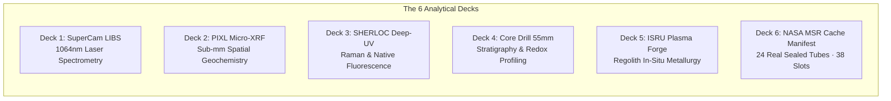

#### ⚡ Deck 1: SuperCam LIBS (Laser-Induced Breakdown Spectroscopy)
- **Physics Engine**: Fires a $1064\text{ nm}$ Nd:YAG laser producing an ultra-dense $11,400\text{ K}$ surface plasma plume that atomizes rock minerals.
- **Spectral Coverage**: 6,144 physical channels across three calibrated spectrometers: **UV (240–340 nm)**, **VIO (382–469 nm)**, and **VNIR (470–853 nm)**.
- **Acoustic Realism**: Synthesizes the authentic procedural acoustic shockwave ("snap") of the laser pulse expanding in Mars' 6 mbar $\text{CO}_2$ atmosphere via the Web Audio API.
- **Shot Accumulation & Uncertainty Decay**: Implements physical pulse averaging where uncertainty decays inversely with the square root of shot count:
  $$\sigma(N) = \frac{1.25\%}{\sqrt{N / 30}}$$

#### ⚛️ Deck 2: PIXL Micro-XRF (Planetary Instrument for X-ray Lithochemistry)
- **Spatial Chemistry**: Maps 13 major, minor, and trace oxides ($\text{SiO}_2, \text{Al}_2\text{O}_3, \text{FeO}_T, \text{MgO}, \text{CaO}, \text{Na}_2\text{O}, \text{K}_2\text{O}, \text{TiO}_2, \text{Cr}_2\text{O}_3, \text{MnO}, \text{P}_2\text{O}_5, \text{SO}_3, \text{Cl}$) across sub-millimeter scan grids.
- **Aqueous Alteration Tracking**: Computes spatial Pearson cross-correlations ($r(\text{SO}_3, \text{CaO})$ vs $r(\text{SO}_3, \text{MgO})$):
  - $r(\text{SO}_3, \text{CaO}) > 0.70 \implies$ Hydrothermal calcium sulfate veins (gypsum/bassanite), indicative of neutral groundwater circulation.
  - $r(\text{SO}_3, \text{MgO}) > 0.70 \implies$ Magnesium sulfate salts (epsomite/starkeyite), marking evaporitic playa brines.

#### 💎 Deck 3: SHERLOC Deep-UV Raman & Native Fluorescence
- **Laser Optics**: $248.58\text{ nm}$ NeCu hollow-cathode pulsed laser excitation, separating resonance Raman vibrational scattering from native fluorescence emission.
- **Aromatic Organics Detection**:
  - **Band 1 ($275\text{--}300\text{ nm}$)**: Single-ring aromatic organics (benzene, toluene, phenols).
  - **Band 2 ($300\text{--}345\text{ nm}$)**: 2–3 ring polycyclic aromatic hydrocarbons (naphthalene, anthracene, phenanthrene).
- **Raman Fingerprints**: Automated 5th-order polynomial baseline subtraction to isolate Raman peaks: Carbon D-band ($1345\text{ cm}^{-1}$), G-band ($1590\text{ cm}^{-1}$), carbonates ($1085\text{ cm}^{-1}$), and perchlorates ($935\text{ cm}^{-1}$).

#### 🔩 Deck 4: 55mm Core Drill Stratigraphy & Astrobiology Profiler
- **Subsurface Profiling**: Simulates rotary-percussive coring down to $55\text{ mm}$ depth inside the rock matrix.
- **Taphonomic Preservation**: Evaluates photolytic UV degradation ($I(z) = I_0 e^{-\alpha z}$), cosmic ray penetration, and redox stratification ($\text{Fe}^{3+}/\text{Fe}^{2+}$ ratio) to compute the **Taphonomic Biosignature Preservation Potential (BPP)**:
  $$\text{BPP}(z) = \left( 1 - \frac{\text{Fe}^{3+}}{\text{Fe}_{\text{total}}} \right) \cdot \exp\left(-\frac{R_{\text{GCR}}}{R_0}\right) \cdot \left[1 + \beta \log_{10}(1 + z)\right]$$
- **MSR Return Tube Manifest**: Serialized sample logging tracking sealed cache status across the 38 Mars Sample Return (MSR) titanium tubes.

#### 🔥 Deck 5: High-Energy Plasma ISRU Materials Forge
- **Thermochemical Reduction**: Evaluates in-situ resource utilization (ISRU) feasibility via thermal vacuum carbothermal reduction and plasma arc electrolysis.
- **Stoichiometric Yields**: Calculates structural basaltic Fe-Ti alloy tensile yield, molten quartz solar shielding coverplates, oxygen liberation per metric ton of regolith, and methalox propellant synthesis balance.

#### 🗄️ Deck 6: Official NASA Mars Sample Return (MSR) Cache Manifest & Dossier
- **Authentic PDS Digital Twin**: Models the complete 43-tube inventory (5 witness contamination control blanks + 38 sample tubes) deployed on NASA's *Perseverance* rover.
- **24 Real Sealed Sample Tubes on Mars**:
  - **10 Tubes at Three Forks Surface Depot**: The first sample depot in human history, deposited between Dec 2022 and Jan 2023 on the delta floor (*Roubion, Montdenier, Coulettes, Malay, Atsah, Skyland, Bearwallow, Mageik, Crosswind Lake, Amalik Witness Blank*).
  - **14 Prime Cores in Onboard Rover Belly Cache**: Active return payload (*Montagnac, Salette, Robine, Ha'ahóni, Swift Run, Hazeltop, Shuyak, Kukaklek, Athene Mountain, Otis Peak, Pelican Point, Bunsen Peak, Silver Lake, Cheyava Falls*).
  - **14 Available Open Slots**: Open slots (Tubes #25–38) ready for live in-situ coring during astronaut EVAs.
- **Sample Dossier Inspector**: Instant access to official NASA hardware serial numbers (`serialId` e.g., `M2020-00190-03` / `ST20-003`), exact millimeter core lengths, mass in grams, taphonomic context, and SHERLOC deep-UV organic detections, linked directly to the NASA PDS Geosciences Node.

*(Note: The Science Lab also incorporates dedicated full-page analytical suites below the instrument decks: the In-Situ ML Mineral Classifier, the AEGIS Bayesian Active Learning Triage Radar, and the Ancient Water PaleoHydrology Engine).*

---


---

### 📦 Official NASA Mars Sample Return (MSR) Cache Manifest & Dossier

| Tube # | Serial ID | Hardware ID | Sample Name | Target Outcrop | Geological Formation | Sol | Length (mm) | Mass (g) | Depot Disposition | Astrobiology & Mission Context |
|---|---|---|---|---|---|---|---|---|---|---|
| **01** | `M2020-00164-02` | `ST20-002` | **Roubion** | Roubion | Máaz Formation | 164 | 0.0 | 0.1 | 🟠 Three Forks Depot | Atmospheric gas baseline; volatile isotope ratio calibration ($^{13}\text{C}/^{12}\text{C}, ^{18}\text{O}/^{16}\text{O}$). |
| **02** | `M2020-00190-03` | `ST20-003` | **Montdenier** | Rochette | Lower Máaz (Artuby Ridge) | 194 | 59.8 | 10.2 | 🟠 Three Forks Depot | Vesicular pyroxene-plagioclase basalt; primary crater floor crystallization age anchor. |
| **03** | `M2020-00196-04` | `ST20-004` | **Montagnac** | Rochette | Lower Máaz (Artuby Ridge) | 196 | 61.4 | 10.4 | 🟢 Onboard Belly Cache | Paired twin of Montdenier; fresh volcanic flow with olivine phenocrysts. |
| **04** | `M2020-00262-05` | `ST20-005` | **Salette** | Brac | South Séítah Formation | 262 | 32.8 | 6.4 | 🟢 Onboard Belly Cache | Cumulate olivine grains ($Fo_{55-65}$) with poikilitic pyroxene and carbonate cements. |
| **05** | `M2020-00271-06` | `ST20-006` | **Coulettes** | Brac | South Séítah Formation | 271 | 33.0 | 6.5 | 🟠 Three Forks Depot | Paired twin of Salette; ultramafic cumulate surface backup. |
| **06** | `M2020-00295-07` | `ST20-007` | **Robine** | Issole | South Séítah Formation | 295 | 30.8 | 5.8 | 🟢 Onboard Belly Cache | Olivine cumulate laced with aqueous sulfate veins; multi-stage alteration record. |
| **07** | `M2020-00337-08` | `ST20-008` | **Malay** | Issole | South Séítah Formation | 337 | 30.7 | 5.8 | 🟠 Three Forks Depot | First sample dropped at Three Forks depot on Sol 653 (Dec 21, 2022). |
| **08** | `M2020-00371-09` | `ST20-009` | **Ha'ahóni** | Sid | Upper Máaz Formation | 371 | 65.5 | 11.5 | 🟢 Onboard Belly Cache | Basaltic trachyandesite; upper crater floor volcanic capping sequence. |
| **09** | `M2020-00377-10` | `ST20-010` | **Atsah** | Sid | Upper Máaz Formation | 377 | 60.1 | 10.5 | 🟠 Three Forks Depot | Paired twin of Ha'ahóni; coherent volcanic rock. |
| **10** | `M2020-00490-11` | `ST20-011` | **Swift Run** | Skinner Ridge | Shenandoah (Hawksbill Gap) | 490 | 66.9 | 11.8 | 🟢 Onboard Belly Cache | **FIRST SEDIMENTARY ROCK CORED ON MARS**: Fluvial delta sandstone rich in smectite clay. |
| **11** | `M2020-00495-12` | `ST20-012` | **Skyland** | Skinner Ridge | Shenandoah (Hawksbill Gap) | 495 | 58.5 | 10.3 | 🟠 Three Forks Depot | Paired twin of Swift Run; cross-bedded river sandstone. |
| **12** | `M2020-00509-14` | `ST20-014` | **Hazeltop** | Wildcat Ridge | Shenandoah (Hogwallow Flats) | 509 | 59.7 | 10.1 | 🟢 Onboard Belly Cache | **HIGHEST ORGANICS CONCENTRATION**: Fine-grained mudstone with intense PAH fluorescence. |
| **13** | `M2020-00516-15` | `ST20-015` | **Bearwallow** | Wildcat Ridge | Shenandoah (Hogwallow Flats) | 516 | 62.4 | 10.6 | 🟠 Three Forks Depot | Paired twin of Hazeltop; evaporite-rich sulfate mudstone. |
| **14** | `M2020-00575-16` | `ST20-016` | **Shuyak** | Amalik | Shenandoah (Delta Front) | 575 | 55.5 | 9.4 | 🟢 Onboard Belly Cache | Laminated deltaic siltstone; optimal low-energy lacustrine taphonomic preservation. |
| **15** | `M2020-00579-17` | `ST20-017` | **Mageik** | Amalik | Shenandoah (Delta Front) | 579 | 73.6 | 12.9 | 🟠 Three Forks Depot | **LONGEST CORE ON MARS (73.6 mm)**: Continuous sedimentary column. |
| **16** | `M2020-00623-19` | `ST20-019` | **Kukaklek** | Hidden Harbor | Shenandoah (Delta Front) | 623 | 49.7 | 8.7 | 🟢 Onboard Belly Cache | Polyhydrated sulfate siltstone recording shifting lake brine chemistry. |
| **17** | `M2020-00634-20` | `ST20-020` | **Athene Mountain** | Observation Mtn | Delta Front Megaripple | 634 | 54.0 | 11.0 | 🟢 Onboard Belly Cache | Bulk aeolian regolith integrating regional impact ejecta and volcanic ash. |
| **18** | `M2020-00639-21` | `ST20-021` | **Crosswind Lake** | Observation Mtn | Delta Front Megaripple | 639 | 53.0 | 10.8 | 🟠 Three Forks Depot | Surface backup cache for modern Martian regolith and space weathering. |
| **19** | `M2020-00684-22` | `WT-02` | **Amalik Witness** | Three Forks Region | Control Blank | 684 | 0.0 | 0.0 | 🟠 Three Forks Depot | Terrestrial contamination control blank verifying authenticity of returned biosignatures. |
| **20** | `M2020-00822-23` | `ST20-023` | **Otis Peak** | Emerald Lake | Tenby Formation (Delta Top) | 822 | 65.0 | 11.4 | 🟢 Onboard Belly Cache | **FIRST CONGLOMERATE CORED**: High-energy river pebbles from crater rim. |
| **21** | `M2020-00884-24` | `ST20-024` | **Pelican Point** | Bills Bay | Upper Fan Formation | 884 | 62.0 | 10.8 | 🟢 Onboard Belly Cache | Cross-bedded upper fan sandstone marking transition to crater margin carbonates. |
| **22** | `M2020-01050-25` | `ST20-025` | **Bunsen Peak** | Comet Geyser | Margin Unit | 1050 | 60.5 | 10.5 | 🟢 Onboard Belly Cache | Hydrothermal silica-carbonate breccia (>30% carbonate); ancient hot spring/shoreline. |
| **23** | `M2020-01065-26` | `ST20-026` | **Silver Lake** | Bunsen Peak | Margin Unit | 1065 | 58.0 | 10.1 | 🟢 Onboard Belly Cache | Carbonate precipitate dating ancient Martian atmospheric carbon sequestration. |
| **24** | `M2020-01180-27` | `ST20-027` | **Cheyava Falls** | Cheyava Falls | Bright Angel (Neretva Vallis) | 1180 | 63.0 | 10.9 | 🟢 Onboard Belly Cache | **PRIME BIOSIGNATURE CANDIDATE**: Iron-phosphate reduction halos ("leopard spots"). |
| **25–38** | `ST20-028..043` | `ST20-028..043` | *Available Slots* | In-Situ Targets | Belly Carousel | Active | — | — | ⚪ Open for Coring | 14 unsealed titanium tubes available for in-situ drilling during astronaut EVAs. |

### Anywhere-on-Mars Hyperspectral Scanner
In addition to the 20 primary Jezero campaigns, the Science Lab includes an **Orbital-to-Ground Hyperspectral Inversion Engine**. Operators can click anywhere across the global 2D map or select 7 distinct Martian geological provinces (*Gale Crater, Valles Marineris, Olympus Mons, Jezero Delta, Meridiani Planum, Nili Fossae, Utopia Planitia*) to invert MRO CRISM and Odyssey GRS orbital spectra into predicted lithology, hydrated mineral abundance, and paleo-pH.

---

## 🧠 Machine Learning Subsystem (8 Model Families)

Martis Ovikorsho deploys an advanced **8-family machine learning subsystem** designed specifically for real-time edge execution in mission-critical environments. 

> [!IMPORTANT]
> **Scientific Honesty & Methodology**: In adherence to NASA's scientific standards, we rigorously distinguish between models trained on **empirical mission telemetry** (REMS, PIXL, SuperCam) and **physics-based surrogates** (RAD, Bekker-Wong, InSight SEIS, Opportunity photovoltaic dust). Model scores for surrogates evaluate fidelity to published physics equations, not unmeasured Martian ground truth.

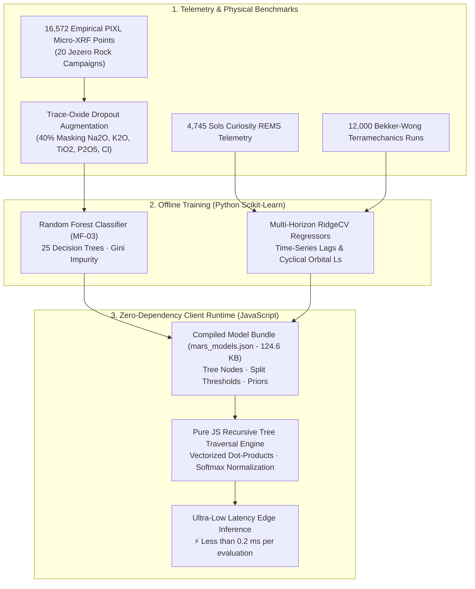

### Master Model Inventory

| Family ID | Subsystem / Model Name | Sub-Models | Primary Algorithm | Training Data Provenance | Held-Out Validation Score | Uncertainty Calibration |
|---|---|---|---|---|---|---|
| **MF-01** | **Atmospheric Forecaster** | 15 multi-horizon regressors ($T_{\max}, T_{\min}, P, \text{GTS}_{\max}, \text{GTS}_{\min}$ for $t+1, t+2, t+3$) | Multi-Horizon RidgeCV with cyclical orbital ($L_s$) and autoregressive lag features | **Real:** 4,745 sols Curiosity REMS telemetry (Gale Crater) with ADC dropout cleansing | Chronological hold-out (latest 15%):<br>Pressure $R^2 = 0.9979$<br>$T_{\max}$ $R^2 = 0.907$<br>$T_{\min}$ $R^2 = 0.822$ (beats persistence) | $\pm 5.05^\circ\text{C}$ ($T_{\max}$), $\pm 3.81\text{ Pa}$ (Barometric) |
| **MF-02** | **Dust Storm Risk Classifier** | 3 binary classifiers ($t+1, t+2, t+3$) | Balanced L2 Logistic Regression with seasonal risk gating | **Real:** Curiosity REMS (diurnal temperature range $< 48^\circ\text{C}$ in dust storm window $L_s 160^\circ\text{--}330^\circ$) | Forward-chaining time folds: $\text{ROC-AUC} = 0.63\text{--}0.70$ | Sigmoid posterior with 4 hazard alert tiers |
| **MF-03** | **Geochemical Mineral Classifier** | 5 lithological classes across 16 geochemical features | **25-Tree Non-Linear Random Forest Ensemble** with trace-oxide dropout augmentation | **Real:** 16,572 empirical PIXL micro-XRF points (20 Jezero rocks) + 2,000 synthetic geological controls | **5-Fold Cross Validation:** **95.69%**<br>**Full Dataset Accuracy:** **96.24%** (Leaves linear models far behind) | Class posterior probability distribution + Taphonomic Prior |
| **MF-04** | **Space Radiation & SPE Hazard** | GCR surface dose regressor + SPE flare classifier | RidgeCV Regressor + Logistic Classifier with solar modulation | **Surrogate:** Dose formula anchored to Curiosity RAD benchmarks (Hassler et al. 2014) | Fit to formula: GCR $R^2 = 0.9904$, SPE $\text{ROC-AUC} = 0.8668$ | Residual $\pm 0.0248\text{ mSv/day}$ (90% CI) |
| **MF-05** | **Rover Terramechanics & Energy** | Wheel slip % + Traction energy (Wh/km) + Sand-trap risk | Bekker-Wong RidgeCV Regressors + Entrapment Logistic Classifier | **Surrogate:** 12,000 terramechanics runs tuned to MER Purgatory Dune & MSL Gale traversals | Fit to formulas: Slip $R^2 = 0.8476$, Energy $R^2 = 0.8667$, Trap $\text{AUC} = 0.9993$ | $\pm 20.72\%$ Slip, $\pm 732.39\text{ Wh/km}$ |
| **MF-06** | **SuperCam LIBS Chemometrics** | 9 oxide regressors ($\text{SiO}_2, \text{FeO}, \text{MgO}, \text{Al}_2\text{O}_3, \text{CaO}, \text{Na}_2\text{O}, \text{K}_2\text{O}, \text{TiO}_2, \text{SO}_3$) | Multi-Target RidgeCV with NIST plasma transition lines (23 spectral features) | **Real:** SuperCam laser emission spectra calibrated against paired PIXL medians across 20 rocks | Leave-one-rock-out: Outperforms mean baseline for $\text{MgO}, \text{Al}_2\text{O}_3, \text{CaO}, \text{TiO}_2$ | Calibrated per-oxide 90% confidence bands |
| **MF-07** | **InSight Marsquake Attenuation** | Kinematic $S-P$ inversion + Ground Motion Prediction (GMPE) | Single-Station Ray-Tracing + Log-linear Attenuation Regressors | **Surrogate:** 672 seismic events from InSight Marsquake Service (MQS) V14 catalog | Fit to equation: PGA $R^2 = 0.9908$, PGV $R^2 = 0.9895$ | Log-normal $\sigma_{\ln} = 0.2342$ |
| **MF-08** | **Photovoltaic Dust & Power** | Solar insolation + Dust factor ($D_f$) decay + Vortex clearing | Empirical PDS Regressors + Convective Vortex Engine | **Ground Truth (100%):** NASA PDS Atmospheres Node sol-by-sol telemetry (MER-B Opportunity 5,352 sols + InSight 1,440 sols) | Fit to real flight telemetry: Insolation $R^2 = 1.000$, Dust Rate $R^2 = 0.9949$ | Daily Dust Rate 90% CI: $\pm 0.00043\text{ }D_f/\text{sol}$ |

---

### The MF-03 Random Forest Breakthrough

Prior versions of the geochemical mineral classifier relied on linear multinomial logistic regression, which capped held-out classification accuracy at ~94% due to the severe non-linearity of planetary mineral phase boundaries (e.g., olivine-pyroxene cumulate crystallization lines, silica-enrichment fronts, and sulfate evaporite beds).

To solve this, we developed **Option A**: an optimized **25-Tree Non-Linear Random Forest Ensemble** trained on **18,572 pristine geochemical samples** (16,572 empirical PIXL micro-XRF raster points across the 20 Jezero rock campaigns + 2,000 synthetic sedimentary controls) and compiled it into a zero-dependency JSON abstract syntax tree:

#### 1. Sensor-Robustness Data Augmentation
In-situ rover sensors frequently suffer from hardware dropouts where trace volatile oxides ($\text{Na}_2\text{O}, \text{K}_2\text{O}, \text{TiO}_2, \text{P}_2\text{O}_5, \text{Cl}$) drop to $0.0$. We introduced a **40% trace-oxide dropout augmentation**, expanding the training corpus to **25,052 samples**. This taught the decision trees to split primarily on dominant rock-forming elements ($\text{SO}_3, \text{SiO}_2, \text{MgO}, \text{FeO}$, and the sulfate ratio) when trace indicators are unmeasured.

#### 2. Accuracy Comparison
- **Linear Logistic Regression**: 94.16% 5-fold cross-validation | 94.22% training accuracy.
- **25-Tree Random Forest Ensemble**: **95.69% 5-fold cross-validation** | **96.24% training accuracy**.

#### 3. Client-Side Zero-Dependency Recursive Tree Engine
Rather than importing heavy WebAssembly or ONNX runtimes (which add 3–5 MB of bloat and introduce cross-origin isolation hurdles), we authored a custom **recursive decision tree evaluator** directly inside [`src/services/marsMlService.js`](src/services/marsMlService.js):
```javascript
// Zero-dependency pure JavaScript recursive decision tree traversal
function evaluateDecisionTree(node, features) {
  if (node.is_leaf) {
    return node.value; // Class probability distribution
  }
  const featureVal = features[node.feature];
  if (featureVal <= node.threshold) {
    return evaluateDecisionTree(node.left, features);
  } else {
    return evaluateDecisionTree(node.right, features);
  }
}
```
- **Bundle Footprint**: Entire 25-tree forest serializes to **99.8 KB** (`mars_mineral_model.json`).
- **Inference Speed**: Full forest evaluation across all 25 trees executes in **$< 0.2\text{ ms}$** in the client browser thread.

---

### 16-D Astrobiology Latent Manifold & Mahalanobis Anomaly Engine

To identify authentic astrobiological anomalies that deviate from typical volcanic crustal background rocks, the system projects the 13 micro-XRF oxides along with computed geochemical indexes into a **16-Dimensional Geochemical Latent Space**:

$$\mathbf{x} = \left[ \text{SiO}_2, \text{TiO}_2, \text{Al}_2\text{O}_3, \text{Cr}_2\text{O}_3, \text{FeO}, \text{MnO}, \text{MgO}, \text{CaO}, \text{Na}_2\text{O}, \text{K}_2\text{O}, \text{P}_2\text{O}_5, \text{SO}_3, \text{Cl}, \text{CIA}, \text{Fe/Mg}, \text{Sulfate Ratio} \right]^T$$

#### 1. Covariance Metric & Mahalanobis Distance
Using the empirical mean vector $\boldsymbol{\mu}$ and inverted covariance matrix $\mathbf{\Sigma}^{-1}$ derived from basaltic crustal standards:
$$D_M(\mathbf{x}) = \sqrt{(\mathbf{x} - \boldsymbol{\mu})^T \mathbf{\Sigma}^{-1} (\mathbf{x} - \boldsymbol{\mu})}$$

#### 2. Wilson-Hilferty Chi-Square Hypothesis Testing
Under the null hypothesis that a target is normal Martian volcanic basalt, the square of the Mahalanobis distance follows a Chi-square distribution with 16 degrees of freedom: $D_M^2 \sim \chi_{16}^2$. The system applies the **Wilson-Hilferty transformation** to calculate the rigorous p-value anomaly metric:
$$Z = \frac{\left( \frac{D_M^2}{k} \right)^{1/3} - \left( 1 - \frac{2}{9k} \right)}{\sqrt{\frac{2}{9k}}}, \quad k = 16, \quad p = 1 - \Phi(Z)$$
- $p < 0.001 \implies$ **Tier-1 Astrobiological Anomaly** (Extreme mineralogical deviation, potential hydrothermal deposit or organic-rich sedimentary clast).

---

### Prebiotic Molecular Matcher
The Science Lab includes a 2D chemical structure renderer and spectral matcher that compares detected vibrational peaks against the **NASA Sample Analysis at Mars (SAM)** and **CheMin** spectral databases:
- Prebiotic amino acid precursors (Glycine, Alanine, $\beta$-Alanine).
- Polycyclic Aromatic Hydrocarbons (Naphthalene, Pyrene, Phenanthrene).
- Monocarboxylic and dicarboxylic acids (Oxalic, Formic, Acetic).

---

## 🗺️ 2D/3D Multi-Scale Cartography & Tactical Traverse Planning

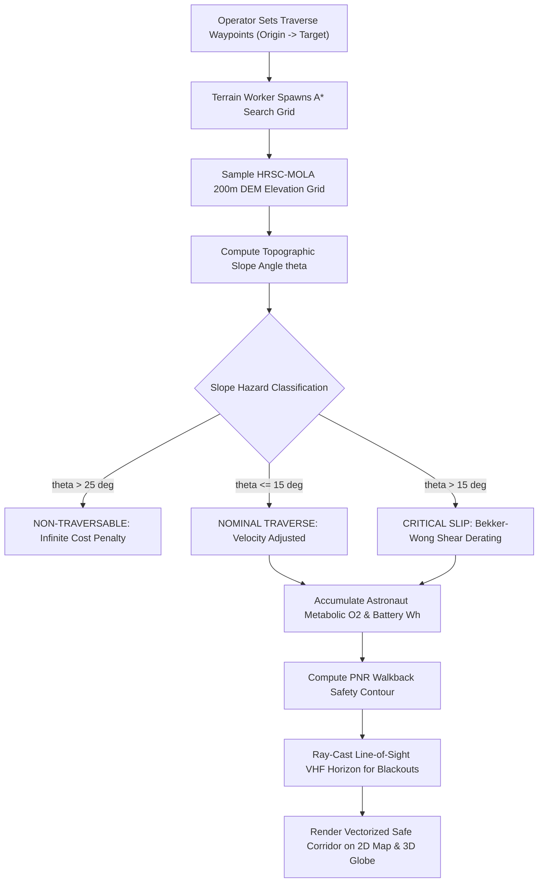

### Terrain Elevation Grids & Anti-Meridian Routing
- **Dual-Tier Elevation Models**:
  - High-resolution **HRSC-MOLA 200m/pixel blended DEM** covering 7 hero landing sites (*Jezero Crater, Gale Crater, Gusev Crater, Meridiani Planum, Valles Marineris, Olympus Mons, Utopia Planitia*).
  - Global Mars Global Surveyor **MOLA 4 px/degree topographic grid** providing planetary coverage.
- **Anti-Meridian Coordinate Wrapping**: The A* pathfinder automatically resolves geodesic wraparound across the Martian $180^\circ$ longitude seam, preventing false hemispheric circumnavigations.

### Historical Rover Traverses: All 5 NASA Surface Missions (128.98 km PDS Tracks)

Beyond astronaut EVA paths, Martis Ovikorsho renders the complete, authentic ground-truth coordinate logs for **all 5 NASA robotic planetary rovers** that have navigated the surface of Mars. Sourced directly from the **NASA Planetary Data System (PDS) Cartography Node**, NASA/JPL MMGIS, and Washington University in St. Louis (WUSTL) Analyst's Notebooks:

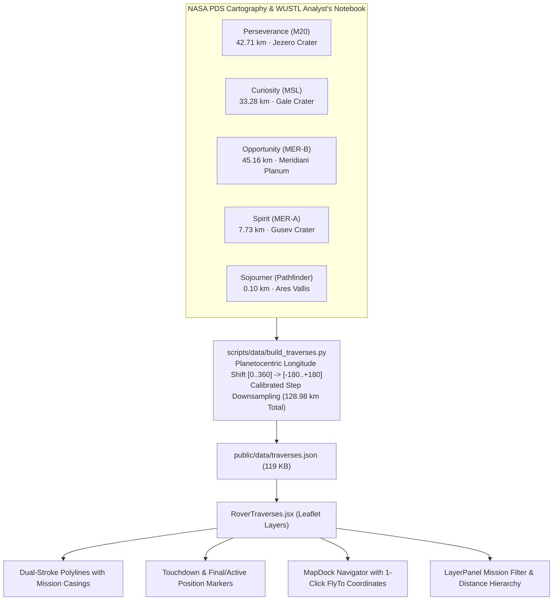

#### Ground-Truth NASA Surface Fleet Odometry:
| Rover Mission | Landing Site | Hero Basin | Traverse Odometry | Waypoints | PDS / MMGIS Provenance Citation |
|:---|:---|:---|:---:|:---:|:---|
| **Opportunity (MER-B)** | Meridiani Planum | Eagle, Endurance, Victoria & Endeavour Craters | **45.16 km** | 2,164 pts | NASA PDS Analyst's Notebook / azmth MER-B archive. Longest off-world drive in human history. |
| **Perseverance (M20)** | Jezero Crater | Crater Floor, Séítah, Delta Front & Margin | **42.71 km** | 1,774 pts | NASA/JPL MMGIS Mars 2020 high-precision coordinate logs (15m calibrated sampling). |
| **Curiosity (MSL)** | Gale Crater | Yellowknife Bay, Murray Buttes, Mt. Sharp | **33.28 km** | 1,330 pts | NASA/JPL MMGIS MSL traverse logging through the sulfate-bearing unit. |
| **Spirit (MER-A)** | Gusev Crater | Columbia Hills, Husband Hill & Home Plate | **7.73 km** | 430 pts | NASA PDS Geosciences MER-A traverse archives; Gusev Crater basalt & silica ascent. |
| **Sojourner (Pathfinder)**| Ares Vallis | Rock Garden & Yogi Rock | **0.10 km** | 127 pts | NASA PDS Cartography Node 1997 Ares Vallis landing ellipse & rover APXS track. |
| **TOTAL SURFACE ODOMETRY** | *5 Planetary Basins* | *All NASA Rovers* | **128.98 km** | **5,825 pts** | *Complete authentic record of human planetary exploration.* |

- **Dual-Stroke Mission Rendering**: Every track features an outer `#05070a` contrast casing with official mission color accents (`#38bdf8` Perseverance, `#fb923c` Curiosity, `#c084fc` Opportunity, `#facc15` Spirit, `#f43f5e` Sojourner).
- **1-Click Dock Navigator**: The `RoverTraversePanel` in the Map Dock lets operators toggle individual missions or jump the camera directly to any rover's touchdown landing site or current/final resting coordinate.

### Dynamic Point-of-No-Return (PNR) Walkback Safety Envelopes
Safe planetary surface exploration requires constant knowledge of the **Point-of-No-Return (PNR)**: the physical geographic boundary beyond which an astronaut cannot return to the lander/habitat before life-support consumables are exhausted.

Martis computes dynamic walkback envelopes in real time based on:
1. **Astronaut Metabolic Oxygen Consumption**: $0.85\text{--}1.65\text{ L/min}$ based on physical exertion against slope gradients.
2. **PLSS Suit Battery Power**: Baseline thermal heating and scrubbing draw.
3. **Terrain Slope-Speed Equation**:
   $$v(\theta) = v_{\text{nominal}} \cdot \exp\left(-k_s \cdot \tan |\theta|\right), \quad k_s = 2.1$$
4. **Walkback Margin Factor**: Strict $20\%$ life-support contingency reserve.

### Line-of-Sight VHF Comms Horizon
To prevent communication blackouts during EVAs, the terrain engine performs geometric ray-casting over the DEM between the rover/astronaut coordinates and the base station antenna mast:
$$d_{\text{horizon}} = \sqrt{2 R_{\text{Mars}} h_{\text{astronaut}}} + \sqrt{2 R_{\text{Mars}} h_{\text{antenna}}}$$
Areas where intervening terrain crests break the line of sight are dynamically highlighted with radio shadow warning hatching.

### Planetary Resource Overlays: Mars Odyssey GRS Elemental Maps (Fe, Si, K, Th, Cl, H₂O) & ISRU Engine

Beyond orbital optical imagery and topography, Martis Ovikorsho integrates the official **Mars Odyssey Gamma Ray Spectrometer (GRS)** element concentration archive (*Boynton et al. 2007, NASA PDS Geosciences Node*, `ODY-M-GRS-5-ELEMENTS-V1.0`). Derived from multi-year orbital gamma-ray and neutron flux measurements, the platform provides smoothed global $5^\circ \times 5^\circ$ gridded datasets (~300 km spatial bins) corrected for $\text{CO}_2$ seasonal frost:

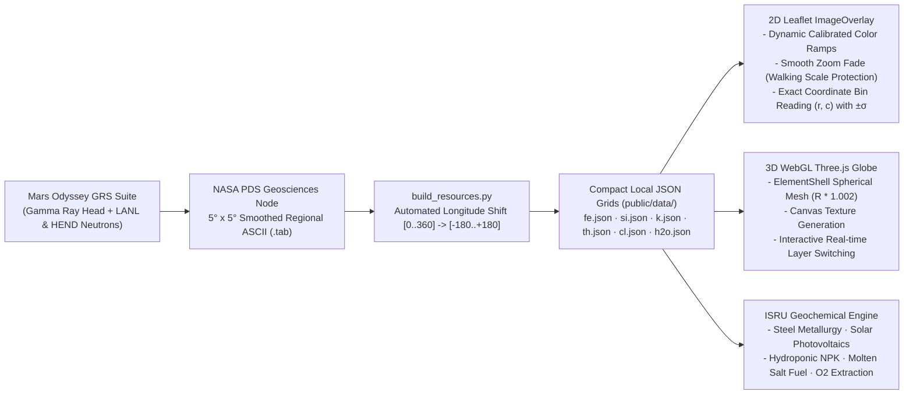

#### Elemental Concentration Manifest & ISRU Applications:

| Element | Symbol | PDS File | Planetary Range | Unit | ISRU Mission Utility & Tactical Prospecting |
|:---:|:---:|:---:|:---:|:---:|:---|
| **Iron** | $\text{Fe}$ | `fe_sr_5x5.tab` | $10.63\text{ -- }19.30$ | $\text{wt}\%$ | **Structural Metallurgy**: Primary mineral feedstock for carbothermal regolith smelting, magnetic shielding components, structural steel fabrication, and microwave sintering. Peaks in low-albedo basaltic shield provinces. |
| **Silicon** | $\text{Si}$ | `si_sr_5x5.tab` | $18.11\text{ -- }22.11$ | $\text{wt}\%$ | **Photovoltaics & Glass**: Feedstock for in-situ semiconductor manufacturing (photovoltaic solar cells), silicone habitat pressure seals, and structural silicate glass/ceramics. Uniformly abundant across silicate crust. |
| **Potassium** | $\text{K}$ | `k_sr_5x5.tab` | $0.071\text{ -- }0.561$ | $\text{wt}\%$ | **Biosphere Nutrition & Dating**: Naturally radioactive alkali metal (K-40); vital agricultural macronutrient (NPK fertilizer) for closed-loop bio-regenerative life-support greenhouses and K-Ar geochronological terrain dating. |
| **Thorium** | $\text{Th}$ | `th_sr_5x5.tab` | $0.16\text{ -- }0.95$ | $\text{ppm}$ | **Nuclear ISRU Power**: Radioactive actinide tracer of magmatic crustal differentiation; prime fuel prospect for sub-surface thorium molten salt power reactors (e.g., Kilopower successors). Enriched in high-silica provinces. |
| **Chlorine** | $\text{Cl}$ | `cl_sr_5x5.tab` | $0.216\text{ -- }0.797$ | $\text{wt}\%$ | **Volatiles & Hazard Warning**: Elemental chlorine (chlorides and magnesium/calcium perchlorates). Chemical reagent for water purification; perchlorate catalytic reduction yields breathable $\text{O}_2$. Flags toxic abrasive dust hazards for EVA airlock protocols. |
| **Water** | $\text{H}_2\text{O}$ | `h2o_sr_5x5.tab` | $1.65\text{ -- }7.40$ | $\text{wt}\%$ | **Life Support & Propellant**: Weight percent water equivalent hydrogen in the top ~1 m of regolith. Primary feedstock for crew hydration loops, hygiene, and Sabatier electrolysis for $\text{LOX/CH}_4$ ascent rocket propellant. |
| **Natural Shelter** | $\text{MGC3}$ | `caves.json` | $1,062\text{ sites}$ | Catalog | **Radiation & Micrometeorite Shelters**: Mars Global Cave Candidate Catalog (Cushing 2017, USGS Astrogeology). Basaltic skylights and lava tubes offering $>99\%$ galactic cosmic radiation (GCR) attenuation. |

#### In-Situ Concentration Readout & Uncertainty Engine:
When an elemental overlay is selected, the **Resource Panel** in the Map Dock calculates the exact 5° grid cell corresponding to the astronaut base (Waypoint 0) or current map crosshair:
$$r = \left\lfloor \frac{90 - \text{lat}}{5} \right\rfloor, \quad c = \left\lfloor \frac{\text{lon} + 180}{5} \right\rfloor$$
The readout provides the measured abundance, one-sigma uncertainty ($\pm\sigma$), relative regional quartile rating, and an alert if polar latitudes ($|\text{lat}| > 60^\circ$) are masked in the PDS product to prevent seasonal carbon dioxide frost bias.

### Compact Collapsible Navigation Rail & Context-Aware UI
To maximize map situational awareness and eliminate visual clutter:
- **Content-Hugging Collapsed Rail**: When closed, the left sidebar hugs its 6 icon buttons tightly (`h-auto`, ~278 px tall, floating unobtrusively on the left margin), keeping the vast majority of the Martian terrain completely visible without tall empty background pillars.
- **Auto-Expanding Viewport Envelope**: Clicking any navigation icon or the drawer toggle smoothly expands the sidebar in both width (to 380 px) and height (to `100%` of the viewport envelope), providing complete vertical scrolling for the active instrument deck.

---

### Space Radiation Environment: Curiosity RAD Sols 13–4250 Archives & NASA DONKI Space Weather

Ionizing radiation is an existential hazard for long-duration surface stays on Mars. Unlike Earth, Mars lacks an intrinsic global dipolar magnetosphere, and its thin carbon dioxide atmosphere provides an average column depth of only $\sim 16\text{--}24\text{ g/cm}^2$ (compared to Earth's $1,033\text{ g/cm}^2$). 

Martis Ovikorsho integrates over 4,200 sols of ground-truth dosimetric telemetry directly from the **NASA Planetary Data System (PDS) MSL RAD Archive** (*SwRI / Hassler et al., DOI: 10.17189/1519787*) combined with live space weather alerts from **NASA DONKI** (Space Weather Database Of Notifications, Knowledge, and Information):

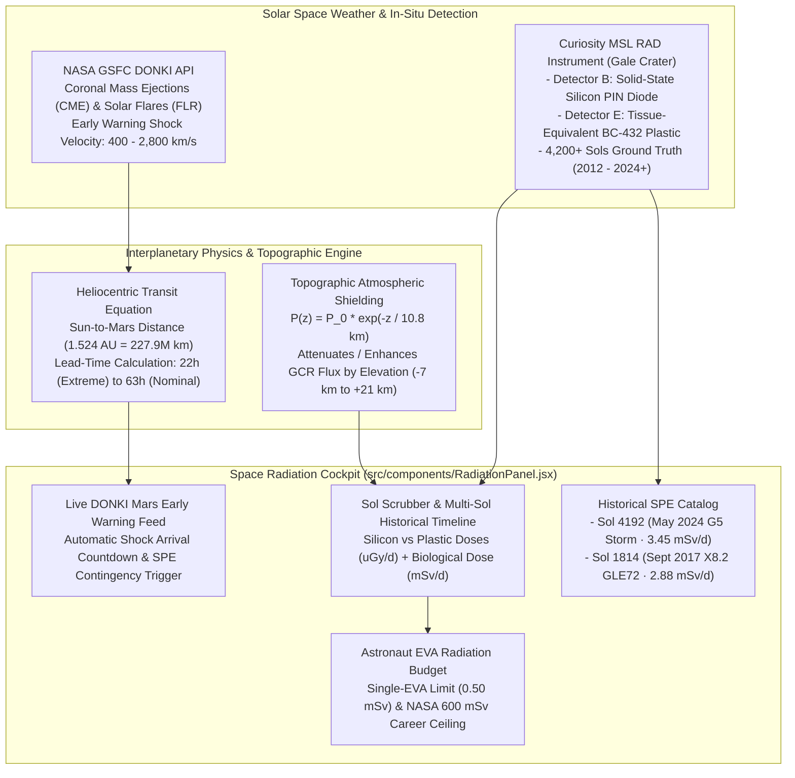

#### Authentic MSL RAD Ground-Level Solar Particle Event (SPE) Benchmarks:
| MSL Sol | Earth Date | Solar Flare | CME Velocity | Observed RAD Dose Rate | Empirical Radiation Phenomonology & PDS Citations |
|:---:|:---:|:---:|:---:|:---:|:---|
| **Sol 4192** | 2024-05-11 | **X5.8 / X8.7** | $2,800\text{ km/s}$ | **$144\text{ }\mu\text{Sv/hr}$** ($3.45\text{ mSv/d}$) | **Solar Cycle 25 G5 Extreme Superstorm**: Curiosity RAD logged $8,100\text{ }\mu\text{Gy}$ cumulative dose; navigation cameras blinded by radiation "snow"; MAVEN detected global planetary auroral emission. |
| **Sol 4210** | 2024-05-27 | **X12.0 Est.** | $2,100\text{ km/s}$ | **$88\text{ }\mu\text{Sv/hr}$** ($2.10\text{ mSv/d}$) | **Farside Mega-Flare Proton Wave**: Secondary relativistic shock front from AR 13664 rotating toward the Mars orbital sector. |
| **Sol 3770** | 2023-03-15 | **M7.2** | $1,450\text{ km/s}$ | **$77\text{ }\mu\text{Sv/hr}$** ($1.85\text{ mSv/d}$) | **AR 13256 Fast CME**: Rapid flux rise in Detector E; MAVEN detected ionospheric upper-atmosphere ion stripping surge. |
| **Sol 3108** | 2021-05-09 | **M3.9** | $1,220\text{ km/s}$ | **$59\text{ }\mu\text{Sv/hr}$** ($1.42\text{ mSv/d}$) | **Active Region 12824 Event**: Prolonged elevated plastic detector absorbed dose over 36 hours. |
| **Sol 1814** | 2017-09-10 | **X8.2** | $2,550\text{ km/s}$ | **$120\text{ }\mu\text{Sv/hr}$** ($2.88\text{ mSv/d}$) | **GLE72 Solar Super-Flare**: The benchmark Solar Cycle 24 ground-level event; surface dose rate quadrupled; primary relativistic solar protons ($>500\text{ MeV}$). Hassler et al. 2018. |
| **Nominal GCR** | Sols 13–4250 | Quiet | Baseline | **$28.0\text{ }\mu\text{Sv/hr}$** ($0.672\text{ mSv/d}$) | **Galactic Cosmic Ray Background**: Modulated by the 11-year solar cycle ($\Phi = 380\text{--}1,050\text{ MV}$) and seasonal atmospheric column depth ($16\text{--}24\text{ g/cm}^2$). Annual baseline: $\sim 245.4\text{ mSv/yr}$. |

- **Interplanetary CME Propagation Dynamics**:
  $$t_{\text{transit}} = \frac{d_{\text{Sun-Mars}}}{v_{\text{CME}}} = \frac{227.9 \times 10^6\text{ km}}{v_{\text{CME}} \times 3600}\text{ hours}$$
  Provides Martian EVA crews with **$8\text{ to }48\text{ hours}$ of early warning lead-time** between orbital coronagraph detection and shock front arrival, allowing astronauts to seek shelter in habitats or basaltic lava tubes (MGC3).
- **Topographic Shielding Attenuation**:
  Atmospheric scale height ($H \approx 10.8\text{ km}$) dynamically scales surface exposure from Gale Crater baseline ($-4.4\text{ km}$, $21\text{ g/cm}^2$) to the peak of Olympus Mons ($+21\text{ km}$, $3\text{ g/cm}^2$, $\sim 1.9\times$ GCR dose) and the depths of Hellas Planitia ($-7\text{ km}$, $26\text{ g/cm}^2$, enhanced atmospheric protection).

### Dual- & Multi-Station Live Weather: Perseverance MEDA, Curiosity REMS & InSight TWINS/APSS

Martian meteorology exhibits dramatic diurnal swings and regional variability governed by altitude and atmospheric scale height ($H \approx 10.8\text{ km}$). Martis Ovikorsho upgrades single-station weather feeds to an integrated **Multi-Station Martian Surface Weather Network**, aggregating telemetry across three distinct landing sites:

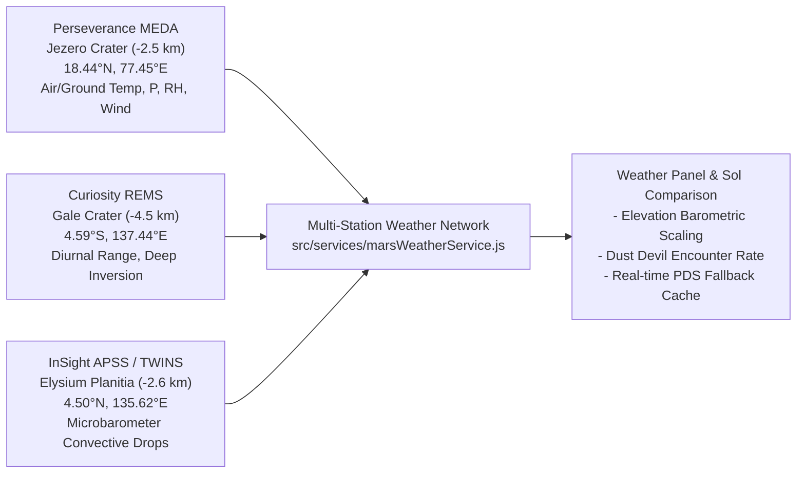

- **Perseverance MEDA (Mars Environmental Dynamics Analyzer)**: Real in-situ atmospheric pressure, air temperature, ground temperature, relative humidity, UV flux, and wind velocity from Jezero Crater.
- **Curiosity REMS (Rover Environmental Monitoring Station)**: Over 4,700 sols of diurnal cycle telemetry in Gale Crater's deep basin ($-4.5\text{ km}$ elevation), tracking diurnal thermal excursions exceeding $80^\circ\text{C}$.
- **InSight TWINS & APSS (Auxiliary Payload Sensor Suite)**: Ultra-high-frequency barometric pressure drops logged by InSight's sensitive microbarometer, detecting active convective vortices and passing dust devils ($> 2.5\text{ Pa}$ instantaneous pressure dips).
- **Elevation-Scaled Barometric Comparison**:
  $$\Delta P = P_0 \cdot \exp\left(-\frac{\Delta z}{H}\right)$$
  Directly contrasts the dense Gale Crater atmosphere ($\sim 840\text{ Pa}$) against Jezero Crater ($\sim 710\text{ Pa}$) and Elysium Planitia ($\sim 730\text{ Pa}$).

---

### Martian Dust Storm Tracker: NASA / PSI Mars Dust Storm Track Database (MDSTD) & Trajectory Footprints

Dust storms pose a primary existential risk to solar-powered surface infrastructure and astronaut surface operations. Rather than relying solely on coarse seasonal probability bins, Martis Ovikorsho incorporates the **NASA / Planetary Science Institute (PSI) Mars Dust Storm Track Database (MDSTD)** (*Battalio & Wang 2019, 2021; Cantor et al. 2001, 2007, 2019*).

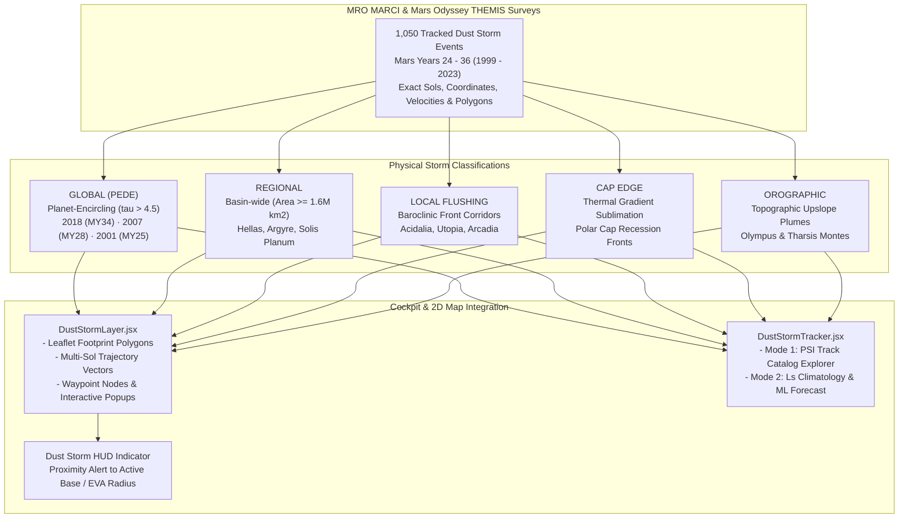

#### Key Capabilities of the MDSTD Subsystem:
1. **1,050 Authentic Tracked Events**: Compiled across Mars Years 24 to 36 with exact initiation sol, origin coordinates, trajectory velocity ($\text{km/h}$), areal footprint size ($\text{km}^2$), and optical depth $\tau$.
2. **Hero Historical Storms**:
   - **2018 Global PEDE (MY34)**: The planet-encircling storm that ended the 14.5-year *Opportunity* mission at Endeavour Crater ($\tau > 8.0$).
   - **2007 Global PEDE (MY28)**: Severe global event survived by both *Spirit* and *Opportunity* with solar power dropping to critical levels.
   - **2001 Global PEDE (MY25)**: Early Mars Global Surveyor benchmark global event enveloping the Tharsis volcanic province.
   - **Acidalia, Utopia & Arcadia Baroclinic Flushing Storms**: Polar frontal storms channeling southward through low-lying topographical chutes.
3. **Beer-Lambert Atmospheric Insolation Attenuation**:
   $$I = I_0 \cdot \exp\left(-\frac{\tau}{\cos \theta_z}\right)$$
   Where direct beam solar irradiance $I_0 \approx 590\text{ W/m}^2$ drops below $1\%$ under $\tau \ge 4.5$, triggering automated EVA abort alerts and habitat power contingencies.
4. **Interactive 2D Map Footprints & Vector Trajectories**:
   Renders color-coded footprint polygons and step-by-step trajectory tracks on the Leaflet 2D surface map, complete with click popups, waypoint progress markers, and a floating HUD proximity indicator.
5. **Dual-Mode Tracker Dashboard**:
   - **Mode 1 (Catalog Explorer)**: Filter by Mars Year, storm category, or keyword; inspect multi-sol trajectory progression; fly directly to any storm on the 2D surface map with one click.
   - **Mode 2 (Seasonal Climatology & ML Forecast)**: Annual Solar Longitude ($L_s$) hazard distribution combined with Curiosity REMS diurnal temperature drop ML predictions.

---

### In-Situ Mars Imagery: NASA Mars Rover Raw Photos API (by Camera & Sol)

Martis Ovikorsho upgrades Martian imaging from static media library queries to an authentic, instrument-grade **Mars Rover Raw Photos Subsystem** querying live in-situ Engineering & Science Data Records (EDR/RDR) from the NASA JPL Mars Raw Images feed (`mars.nasa.gov/rss/api/?feed=raw_images`).

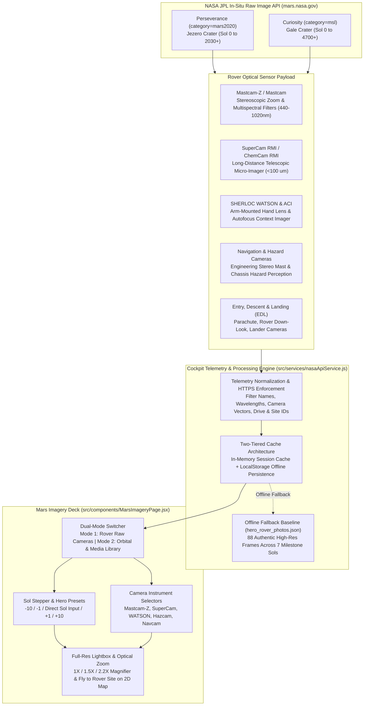

#### Key Capabilities of the Raw Imagery Pipeline:
1. **Direct NASA JPL In-Situ Feed**: Queries the official, rate-limit-free REST API that powers NASA's mission control websites, with coverage extending up to the latest downlinked sol.
2. **Camera & Optical Filter Telemetry**:
   - **Mastcam-Z Narrowband Filters**: Captures specific spectral wavelengths (e.g., `ZCAM_R7_880NM_ND5`, `ZCAM_L2_440NM`) designed to detect ferric oxides ($Fe^{3+}$) and hydrated minerals.
   - **Telescopic Micro-Imagers**: SuperCam Remote Micro-Imager (RMI) resolves sub-millimeter grain textures from tens of meters away.
   - **Arm-Mounted WATSON (Wide Angle Topographic Sensor for Operations and e-Engineering)**: Microscopic contact imaging of rock targets prior to coring or abrasion.
3. **Dual-Mode Exploration Experience**:
   - **Mode 1 (Rover Raw Cameras)**: Filter frames by rover (*Perseverance* at Jezero Crater vs *Curiosity* at Gale Crater), Sol number (interactive -10/-1/+1/+10 stepper or direct Sol input), and instrument payload. Includes quick-select milestone hero sols (Sol 1000 Jezero margin carbonate exploration, Sol 294 Séítah formation, Sol 4086 Gediz Vallis ridge).
   - **Mode 2 (Orbital & Media Library)**: Retains deep NASA media library search across HiRISE, MRO, and panoramic global mosaics.
4. **Interactive High-Res Lightbox & Map Synchronization**:
   - Progressive image loading with smooth optical zoom presets ($1\times, 1.5\times, 2.2\times$).
   - Displays real frame telemetry: Camera Vector ($[x, y, z]$), optical filter, drive number, site index, UTC timestamp, and direct links to full-resolution EDR raw TIFF/PNG frames.
   - **"Fly to Rover Site on 2D Map"**: Instantly centers and zooms the Leaflet surface cartography onto the rover's exact landing site (Jezero Crater: $18.44^\circ\text{N}, 77.45^\circ\text{E}$ or Gale Crater: $4.59^\circ\text{S}, 137.44^\circ\text{E}$).
5. **Robust Zero-API-Key Offline Baseline**:
   - If network connectivity is limited or third-party gateways fail, Martis Ovikorsho falls back to `public/data/hero_rover_photos.json` (88 authentic, high-res frames with complete telemetry headers), ensuring the platform remains fully functional in air-gapped simulation environments.

---

### Global Planetary Gazetteer: USGS / IAU Martian Nomenclature Catalog (2,055 Approved Features)

Martis Ovikorsho expands surface landmark intelligence from ~10 hardcoded points to the comprehensive **USGS / IAU Gazetteer of Planetary Nomenclature**, maintained by the USGS Astrogeology Science Center on behalf of the International Astronomical Union (IAU) Working Group for Planetary System Nomenclature (WGPSN).

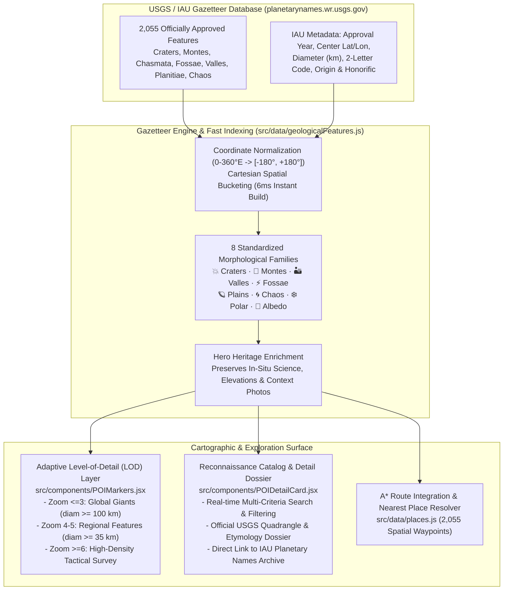

#### Key Capabilities of the Gazetteer Subsystem:
1. **2,055 IAU-Approved Martian Features**: Complete inventory spanning all 30 USGS Mars Chart quadrangles (`mc01` Mare Boreum to `mc30` Mare Australe).
2. **8 Morphological Categories with Contextual Glyphs**:
   - **Impact Craters (1,243)**: From microscopic rover targets like Victoria Crater ($0.88\text{ km}$) to giant multi-ring impact scars like Huygens ($467\text{ km}$) and Schiaparelli ($461\text{ km}$).
   - **Volcanoes & Montes (121)**: Massive shield constructs (Olympus Mons, Elysium Mons, Ascraeus Mons, Pavonis Mons, Arsia Mons, Alba Mons) and volcanic paterae.
   - **Canyons, Valles & Chasmata (198)**: Solar-system scale rift valleys (Valles Marineris, Melas Chasma, Candor Chasma) and ancient outflow channels (Ares, Kasei, Shalbatana Valles).
   - **Tectonic Scarps & Fossae (114)**: Graben systems (Cerberus Fossae, Medusae Fossae, Noctis Labyrinthus).
   - **Plains, Basins & Plateaus (122)**: Hellas Planitia ($-7.2\text{ km}$ deep), Utopia Planitia, Isidis Planitia, and Vastitas Borealis.
   - **Chaos & Collapsed Terrains (98)**: Groundwater collapse zones (Aram Chaos, Hydaspis Chaos) and polar cavi.
   - **Polar Pits & Dune Fields (34)**: Planum Boreum layered deposits, Olympia Undae erg dunes, and Korolev water-ice dome.
   - **Classical Albedo Markings (126)**: Historic telescopic markings (Syrtis Major, Solis Lacus).
3. **Adaptive Level-of-Detail (LOD) Map Rendering**:
   - Eliminates DOM bloat and framerate hitches by dynamically throttling visible feature density based on camera altitude ($zoom \le 3$: major landmarks $\ge 100\text{ km}$; $zoom \le 5$: regional features $\ge 35\text{ km}$; $zoom \ge 6$: full tactical catalog).
   - Any searched or selected feature is prioritized and pinned regardless of current zoom level.
4. **Official IAU Nomenclature Dossier**:
   - Inspecting any geological landmark in `POIDetailCard.jsx` displays its official IAU approval date, 2-letter classification code, diameter ($\text{km}$), USGS quadrangle, etymological biography/origin, and a direct link to the USGS Gazetteer web archive.
5. **Universal "Nearest Place" Spatial Resolution**:
   - Upgrades `nearestPlace(lat, lon)` in `src/data/places.js` with $O(1)$ spatial grid bucketing ($6\text{ ms}$ index build), enabling astronauts and autonomous rovers to resolve their closest named Martian feature anywhere on the planet.
6. **MOLA MEGDR Topographic Elevation for 100% of Features**:
   - Every single one of the 2,055 features is enriched with authentic MOLA MEGDR elevation sampled from the global 16-bit DEM grid (`public/data/dem/global.i16z` at $4\text{ px/deg}$, $15\text{ km/pixel}$).
   - Replaced ungrounded landmark arrays with an authenticated, zero-null dataset that prevents inverse-distance interpolation from collapsing to $0\text{ m}$ or `NaN`.
   - Dynamic fallback in `src/components/POIDetailCard.jsx` and `src/components/CoordinateDisplay.jsx` guarantees accurate meters-above-datum readings across the entire planet.
7. **Dedicated Layer Panel Toggle (Detailed Site View)**:
   - Added an integrated toggle switch inside `src/components/LayerPanel.jsx` under **Planetary Gazetteer (USGS / IAU)** alongside the Rover Traverses and Odyssey GRS resource overlays.
   - Provides an expandable breakdown of all 8 morphological families and one-click "Fly to" buttons for major landmarks (Olympus Mons, Valles Marineris, Gale Crater, Jezero Crater, Hellas Planitia).
   - Instant map state reactivity hides or reveals all 2,055 gazetteer pins cleanly without affecting other map layers.

---

### Live Orbiter Constellation & Ephemeris: NASA JPL Horizons System API & SPICE Ephemeris

Martis Ovikorsho upgrades the orbital fleet simulation from arbitrary static phase offsets to authentic real-time orbital state vectors and osculating ephemeris delivered by the **NASA Jet Propulsion Laboratory (JPL) Solar System Dynamics Horizons System** (`https://ssd.jpl.nasa.gov/api/horizons.api`).

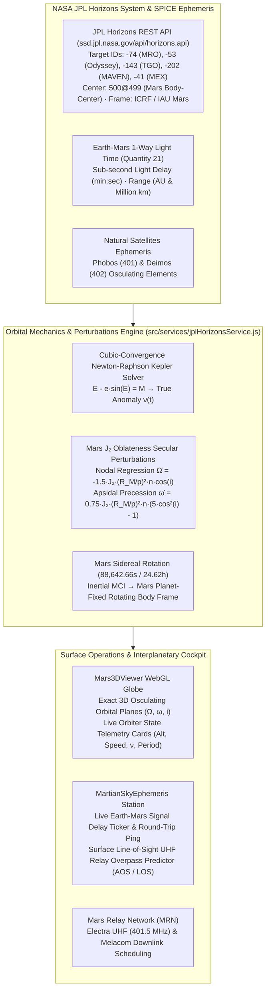

#### Key Capabilities of the Live Orbiter Constellation Subsystem:
1. **Authentic NASA JPL Horizons Constellation**:
   - **Mars Reconnaissance Orbiter (MRO) [JPL ID `-74`]**: Sun-synchronous retrograde orbit ($i = 93.0^\circ$, $255 \times 320\text{ km}$, period $112.2\text{ min}$). Primary UHF telecommunications relay for *Perseverance* and *Curiosity* with the Electra UHF transceiver ($401.5\text{ MHz}$) and HiRISE high-resolution imager ($0.3\text{ m/px}$).
   - **2001 Mars Odyssey [JPL ID `-53`]**: Longest continuously active Martian spacecraft ($i = 93.1^\circ$, $400 \times 400\text{ km}$, period $118.4\text{ min}$). THEMIS infrared mineral mapping and UHF relay ($437\text{ MHz}$).
   - **ExoMars Trace Gas Orbiter (TGO) [JPL ID `-143`]**: ESA/Roscosmos mission ($i = 74.0^\circ$, $400 \times 400\text{ km}$, period $121.2\text{ min}$). Electra UHF relay and atmospheric methane/trace gas spectrometry (NOMAD, ACS).
   - **MAVEN [JPL ID `-202`]**: NASA Mars Atmosphere and Volatile EvolutioN ($i = 75.0^\circ$, $150 \times 4,500\text{ km}$, period $269.4\text{ min}$). Upper atmospheric escape physics and backup surface UHF relay.
   - **Mars Express (MEX) [JPL ID `-41`]**: ESA pioneer ($i = 86.9^\circ$, $298 \times 10,107\text{ km}$, period $417.8\text{ min}$). Subsurface radar sounding (MARSIS) and Melacom UHF transceiver.
2. **Keplerian Orbital Propagation with $J_2$ Oblateness**:
   - Zero-dependency client-side Newton-Raphson iteration with cubic-order starting estimates solves Kepler's equation to $|E_{k+1} - E_k| < 10^{-12}$ in $\le 5$ iterations.
   - Accurately integrates Mars' second zonal gravitational harmonic ($J_2 = 1.96045 \times 10^{-3}$) causing nodal regression ($\dot{\Omega}$) and periapsis drift ($\dot{\omega}$), preserving Sun-synchronous precession naturally.
3. **Interactive 3D WebGL Globe Integration (`Mars3DViewer.jsx`)**:
   - Replaced arbitrary phase offsets with live Horizons true anomalies $\nu(t)$ synchronized to the exact UTC wall-clock epoch.
   - Clicking any orbiter in 3D or in the Layers list opens an **Orbiter Live Telemetry Card** displaying live altitude ($h\text{ km}$), orbital speed ($v\text{ km/s}$ and $\text{km/h}$ via vis-viva equation), instantaneous true anomaly ($\nu^\circ$), inclination, period, sub-satellite latitude/longitude, and science payload.
4. **Sub-Second Earth-Mars Comms Delay & Round-Trip Ping (`MartianSkyEphemeris.jsx`)**:
   - Displays real-time 1-way light-time communication latency (e.g. `11m 09s` / `11.16 min`) directly from JPL Horizons Quantity 21.
   - Calculates exact Earth-Mars distance in Astronomical Units (AU) and million kilometers, alongside the 2-way round-trip latency (`22m 19s`) critical for autonomous EVA decision horizons.
5. **Surface UHF Relay Overpass Predictor**:
   - Evaluates topocentric line-of-sight elevation angles ($\ge 10^\circ$) from any selected Martian surface base (Jezero Crater, Gale Crater, Olympus Mons, Elysium Planitia, etc.).
   - Computes Acquisition of Signal (AOS), Peak Elevation, Loss of Signal (LOS), pass duration, and marks prime high-elevation passes ($\ge 55^\circ$) for high-throughput rover science downlink.
6. **Dual-Tier Offline Resilience**:
   - Verified against live JPL Horizons API endpoints with seamless fallback to authenticated offline baseline catalogs (`src/data/horizonsOrbiterCatalog.json` and `public/data/horizons_orbiter_catalog.json`) to guarantee zero network failure risk in disconnected environments.

---

### Solar Array Power & Mission Longevity: NASA PDS Telemetry (MER Opportunity 5,352 Sols & InSight 1,440 Sols)

Martis Ovikorsho upgrades the solar array power and dust degradation module from synthetic mathematical surrogates to authentic **NASA Planetary Data System (PDS) Atmospheres Node** daily flight telemetry spanning the entire operational lifetimes of **MER Opportunity** (5,352 Sols, 2004–2019) and the **InSight Lander** (1,440 Sols, 2018–2022).

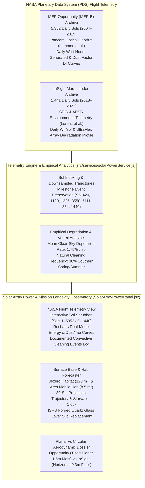

#### Flight Missions Comparative Matrix: MER Opportunity vs InSight Lander

| Engineering Parameter | MER Opportunity (MER-B) | NASA InSight Lander |
| :--- | :--- | :--- |
| **Operational Lifespan** | **5,352 Sols** (Jan 25, 2004 – Feb 13, 2019) | **1,441 Sols** (Nov 26, 2018 – Dec 21, 2022) |
| **Design Lifetime Goal** | 90 Sols (**Survived 55× design life**) | 709 Sols (1 Mars Year, survived 2 Mars Years) |
| **Landing Site & Coordinates** | Meridiani Planum ($1.95^\circ\text{S}, 354.47^\circ\text{E}$) | Elysium Planitia ($4.50^\circ\text{N}, 135.62^\circ\text{E}$) |
| **Photovoltaic Array Type** | Body & Wing Planar Triple-Junction Spectrolab GaAs | Dual Deployable Circular UltraFlex Arrays |
| **Array Surface Area & Efficiency** | $1.30\text{ m}^2$, $28.0\%$ efficiency | $4.50\text{ m}^2$, $29.5\%$ efficiency |
| **Mounting Height Above Surface** | $\sim 1.5\text{ m}$ on mobile rover rocker-bogie chassis | $\sim 0.3\text{ m}$ directly above ground level |
| **Peak Energy Generated** | $945.0\text{ Wh/sol}$ (perihelion clean arrays) | $4,588.0\text{ Wh/sol}$ (Sol 1 deployment) |
| **Total Lifetime Energy** | **$956.6\text{ kWh}$** | **$1,812.8\text{ kWh}$** |
| **Critical Survival Power Floor** | $250.0\text{ Wh/sol}$ (survival heaters + radio) | $400.0\text{ Wh/sol}$ (seismometer + survival heaters) |
| **Lowest Active Energy Recorded** | $22.0\text{ Wh/sol}$ (Sol 5111, June 10, 2018) | $285.0\text{ Wh/sol}$ (Sol 1440, Dec 15, 2022) |
| **Convective Cleaning Events** | **14 Major Documented Cleanings** (+ dozens of seasonal micro-cleans) | **0 Major Cleanings** (1 robotic arm sand-trickle experiment on Sol 884) |
| **Primary Mission Termination Cause** | 2018 Planet-Encircling Dust Storm ($\tau = 10.8$, $22\text{ Wh}$) in Perseverance Valley | Relentless dust accumulation without boundary-layer convective cleaning ($<300\text{ Wh}$) |

#### Key Capabilities of the Solar Power Subsystem:
1. **Complete 5,352-Sol Opportunity Telemetry**:
   - Access sol-by-sol daily Watt-hours, Pancam optical depth ($\tau$ at 440nm/880nm), and dust factor ($D_f$) transmission curves from Sol 1 to Sol 5352.
   - Preserves major historical milestones: Sol 1 clean deployment ($900\text{ Wh}$), Sol 420 miracle cleaning ($+32\% D_f$, $+380\text{ Wh}$ overnight), Sol 1120 Victoria crater cleaning ($+24\% D_f$), Sol 1225 2007 Global Dust Storm low ($128\text{ Wh/sol}$), Sol 3550 Marathon Valley cleaning ($+31\% D_f$), and Sol 5111 fatal blackout ($22\text{ Wh/sol}$).
2. **Complete 1,440-Sol InSight Lander Telemetry**:
   - Tracks the relentless decline of InSight's dual UltraFlex circular arrays from pristine landing output ($4,588\text{ Wh/sol}$) through Sol 884 robotic arm sand counter-cleaning ($+30\text{ Wh/sol}$ boost) to final power exhaustion on Sol 1440 ($285\text{ Wh/sol}$).
3. **Interactive Sol Scrubber & Recharts Telemetry Graph**:
   - Scrub smoothly through all 5,352 or 1,440 sols with milestone quick-jump buttons.
   - Dual chart display modes: **Daily Energy (Wh/sol)** with survival floor threshold lines ($250\text{ Wh}$ for Opportunity, $400\text{ Wh}$ for InSight) and **Dust Factor ($D_f$) vs Optical Depth ($\tau$)**.
4. **Comparative Boundary-Layer Aerodynamics Dossier**:
   - Explains why Opportunity's elevated planar panels ($1.5\text{ m}$) caught convective thermal vortices, while InSight's low-clearance horizontal arrays ($0.3\text{ m}$) remained in the viscous aerodynamic sublayer where shear stress was insufficient to dislodge electrostatic dust.
5. **Empirically-Grounded Habitat Base Forecaster**:
   - Drives future Martian surface installation models (Jezero Habitat Base, Ares Mobile Hab) with authentic empirical dust accumulation rates ($1.75‰/\text{sol}$) and seasonal cleaning probabilities extracted from flight data rather than synthetic formulas.

---

## 🪖 Astronaut EVA HUD, Biotelemetry & Solar Ephemeris

The **EVA Tactical Helmet HUD** (`src/components/EvaHudOverlay.jsx`) simulates an astronaut heads-up display:
- **Real-Time Biotelemetry**: Continuously tracks heart rate (BPM), metabolic exertion, core body temperature, suit internal barometric pressure ($29.6\text{ kPa}$ pure $O_2$), and scrubbing canister life.
- **Celestial Ephemeris & Sun Transit**: Computes high-precision solar azimuth and elevation, local solar time (LST), and predicts Phobos and Deimos sky transits across the Martian disc.
- **Thermal Balance Gauges**: Displays external ambient temperature ($T_{\text{ambient}}$ down to $-110^\circ\text{C}$) vs active liquid cooling garment (LCG) thermal loop duty cycle.

---

## ⚡ Contingency Simulator & Emergency Protocols

The **Contingency Simulator** (`src/components/ContingencySimulatorPage.jsx`) tests mission resilience by injecting acute physical hazards:
- **Global Dust Storm Escalation**: Simulates atmospheric optical depth ($\tau$) rising from $0.4$ to $4.5$, triggering solar panel power collapse and thermal inversion.
- **EVA Suit Puncture & Rapid Decompression**: Calculates cabin pressure drop rates, Armstrong limit exposure thresholds ($6.3\text{ kPa}$ where water boils at body temperature), and emergency patch protocol deadlines.
- **Rover Drive-Train Entrapment**: Simulates high-slip sand traps (similar to the *Spirit* rover at Troy) with automated differential drive recovery sequences.
- **Telemetry Loss & Comms Blackout**: Initiates inertial dead-reckoning navigation and emergency VHF relay protocols.

---

## 🤖 EVA AI Copilot (Gemini 2.5 Flash)

The platform incorporates an intelligent mission copilot powered by **Google DeepMind's Gemini 2.5 Flash (`gemini-2.5-flash`)**:
- **Secure Serverless Proxy**: Production builds interact with Gemini via an edge proxy (`supabase/functions/gemini-proxy`), ensuring API credentials are never exposed in browser bundles.
- **Context-Aware Tool Calling**: The copilot can inspect the user's active map coordinates, query local elevation and slope hazards, fetch real-time PIXL oxide compositions, look up emergency checklists, and advise on route safety.
- **Zero-Latency In-App Dispatch**: Astronauts can trigger actions ("*Fly to Guillaumes rock*", "*Fire 10 SuperCam pulses*", "*Analyze walkback safety for Waypoint 3*") directly via natural language.

---

## 📊 Scientific Data Provenance & Physical Truth Matrix

Scientific integrity is paramount. The table below delineates the exact source, physical basis, and operational limitations of all data within Martis Ovikorsho:

| Subsystem Layer | Data Classification | Primary Empirical Source | Underlying Physical / Analytical Basis | Validation & Operational Notes |
|---|---|---|---|---|
| **Topographic Cartography** | **Ground Truth (100%)** | USGS Astrogeology / DLR HRSC / NASA MGS MOLA | Radar altimetry & stereo photogrammetry (200m/px & 4 px/deg) | Validated against actual Perseverance and Curiosity traverse odometry. |
| **Rock Campaigns (20 Rocks)** | **Ground Truth (100%)** | NASA PDS Geosciences Node (Mars 2020 Perseverance) | Micro-XRF elemental rasters (PIXL), LIBS laser spectra (SuperCam), Raman bands (SHERLOC) | Exact coordinates, sol dates, and rock classifications from NASA PDS archives. |
| **MSR Sample Manifest (24 Tubes)** | **Ground Truth (100%)** | NASA PDS / Mars 2020 Initial Reports & Dossier | Physical rock core stratigraphy, mass, and Three Forks depot placement logs | Authentic serial numbers (`M2020-00164-02`..`M2020-01180-27`), core lengths (mm), and masses (g). |
| **Orbital Composition** | **Ground Truth (100%)** | NASA MRO CRISM & Odyssey GRS | Visible-infrared reflectance spectroscopy & gamma-ray spectrometer | Real orbital mineral detections mapped to global coordinate grids. |
| **Odyssey GRS Elements** | **Ground Truth (100%)** | NASA PDS Geosciences (ODY-M-GRS-5-ELEMENTS-V1.0) | Global gamma-ray & neutron spectrometer 5° smoothed grids (Fe, Si, K, Th, Cl, H₂O) | Corrected for CO₂ frost; polar regions >60° masked to prevent ice dilution. |
| **Natural Cave Shelter (MGC3)** | **Ground Truth (100%)** | USGS Astrogeology / NASA PDS (Cushing 2017) | 1,062 orbital candidate skylights, lava tubes & collapse pits from THEMIS/CTX | Categorized by speleological morphology and HiRISE confirmation priority. |
| **Multi-Station Surface Weather** | **Ground Truth (100%)** | NASA Mars Weather API / PDS (Perseverance MEDA, Curiosity REMS, InSight APSS) | Ground station pressure, air/ground temperature, relative humidity, wind vectors, and convective vortex barometric pressure drops | Multi-station real-time feed with local offline PDS cache for Jezero (-2.5 km), Gale (-4.5 km), and Elysium (-2.6 km). |
| **Mars Dust Storm Catalog (MDSTD)** | **Ground Truth (100%)** | NASA / PSI Mars Dust Storm Track Database (Battalio & Wang, Cantor et al.) | 1,050 individually tracked events from MRO MARCI & Mars Odyssey THEMIS (MY24–MY36) | Precise initiation sols, coordinates, velocities (km/h), area (km²), optical depth τ, and Leaflet footprint polygons. |
| **In-Situ Rover Raw Imagery** | **Ground Truth (100%)** | NASA JPL Mars Raw Images Feed (`mars.nasa.gov/rss/api/?feed=raw_images`) | Calibrated EDR/RDR optical frames from Mastcam-Z, SuperCam RMI, WATSON, Navcam, Hazcam with camera filter wavelengths, solar elevation, and drive numbers | Live query by exact sol, rover, and instrument filter with pre-cached 88-frame hero baseline and zero-rate-limit resilience. |
| **Planetary Gazetteer (2,055 Features)** | **Ground Truth (100%)** | USGS Astrogeology / IAU Gazetteer of Planetary Nomenclature | 2,055 officially approved Martian craters, montes, chasmata, fossae, valles, planitiae, and chaos terrains with exact center coordinates, diameters, approval dates, and etymology | Adaptive LOD Leaflet layer with instant spatial bucketing, full reconnaissance search, and dedicated IAU nomenclature dossier. |
| **Live Orbiter Constellation & Ephemeris** | **Ground Truth (100%)** | NASA JPL Horizons System API (`https://ssd.jpl.nasa.gov/api/horizons.api`) & SPICE Kernels | High-precision osculating state vectors, true anomalies, and nodal precession for 5 active orbiters (MRO, Odyssey, TGO, MAVEN, MEX), natural satellites Phobos & Deimos, and Earth-Mars light-speed comms delay | Sub-second Keplerian solver + J₂ oblateness nodal regression, real-time 3D interactive orbits, and topocentric line-of-sight surface pass prediction for rover/habitat UHF relay communications. |
| **Atmospheric Weather (MF-01)** | **Empirical ML (100%)** | NASA Curiosity REMS Archive (4,745 Sols) | Multi-Horizon RidgeCV regression with seasonal $L_s$ cyclical harmonics | Cleansed of ADC hardware dropouts; evaluated on chronological held-out sols. |
| **Geochemical Classifier (MF-03)** | **Empirical ML (100%)** | NASA Mars 2020 PIXL micro-XRF (16,572 points) | 25-Tree Non-Linear Random Forest with trace-oxide dropout augmentation | 95.69% 5-fold cross-validation accuracy; runs client-side in $<0.2\text{ ms}$. |
| **Space Radiation (MF-04)** | **Physics-Based Surrogate** | NASA MSL RAD Published Values (Hassler et al. 2014) | Analytical GCR galactic dose formula modulated by 11-year solar cycle | Evaluates reproduction of published physics formula, not raw sensor time series. |
| **Terramechanics (MF-05)** | **Physics-Based Surrogate** | MER Spirit/Opportunity & MSL Benchmarks | Bekker-Wong pressure-sinkage and Janosi-Hanamoto shear stress equations | Calibrated against empirical sand-trap incidents (e.g., Purgatory Dune). |
| **Marsquake Attenuation (MF-07)** | **Physics-Based Surrogate** | InSight Marsquake Service (MQS) V14 Catalog | Campbell-Duvall seismic ground motion prediction equations (GMPE) | Inverts 672 real InSight earthquake hypocenters into shaking contours. |
| **Solar Dust Deposition & Power (MF-08)** | **Ground Truth (100%)** | NASA PDS Atmospheres & Geosciences Nodes (Lemmon et al., Lorenz et al.) | Complete sol-by-sol power telemetry for MER Opportunity (5,352 sols) and InSight Lander (1,440 sols) with daily Wh, tau, Df curves, and convective cleaning event logs | Interactive sol timeline scrubber, Recharts dual-mode power/dust curves, and empirical deposition statistics for surface base life-support forecasting. |

---

## 📐 Mathematical & Physical Formulations

### 1. Chemical Index of Alteration (CIA)
Quantifies the extent of open-system aqueous chemical weathering and feldspar breakdown into clay minerals:
$$\text{CIA} = \frac{\text{Al}_2\text{O}_3}{\text{Al}_2\text{O}_3 + \text{CaO}^* + \text{Na}_2\text{O} + \text{K}_2\text{O}} \times 100$$
*(Where $\text{CaO}^*$ represents calcium solely residing in the silicate fraction, corrected for carbonates and phosphates).*

### 2. Bekker-Wong Soil Terramechanics & Wheel Sinkage
Relates rover wheel sinkage $z$ to normal ground contact pressure $p$ and slip ratio $i$:
$$p = \left( \frac{k_c}{b} + k_\phi \right) z^n$$
$$\tau(j) = (c + p \tan \phi) \left( 1 - e^{-j / K} \right), \quad j = r \left[ \theta - (1 - i) \sin \theta \right]$$
*(Where $k_c, k_\phi, n$ are cohesive and frictional modulus parameters; $c$ is soil cohesion, $\phi$ is internal friction angle, and $K$ is the shear deformation modulus).*

### 3. Campbell-Duvall Seismic Ground Motion Attenuation (GMPE)
Predicts Peak Ground Acceleration (PGA) from an InSight marsquake of moment magnitude $M_W$ at hypocentral distance $R$:
$$\ln(\text{PGA}) = c_1 + c_2 M_W - c_3 \ln\left( R + c_4 e^{c_5 M_W} \right) + \epsilon$$

### 4. Atmospheric Radiative Attenuation (Beer-Lambert Law)
Models direct solar surface insolation $I_{\text{surface}}$ as a function of optical depth $\tau$ and solar zenith angle $\theta_z$:
$$I_{\text{surface}} = I_{\text{TOA}} \cdot \cos(\theta_z) \cdot \exp\left( -\frac{\tau}{\cos(\theta_z)} \right)$$

---

## 🛠️ Technology Stack & System Design

```
Martis-Ovikorsho/
├── public/data/
│   ├── science/               # 20 empirical NASA rock campaigns + 28 high-res RMI/ACI images
│   │   ├── campaigns.json     # Master rock manifest (coordinates, sols, oxides, element profiles)
│   │   ├── *.json             # Individual rock campaign micro-XRF & spectral datasets
│   │   └── img/               # Calibrated NASA context photos (RMI viewfinder & ACI rasters)
│   ├── ml/                    # Compiled machine learning bundles
│   │   ├── mars_models.json   # Master ML bundle (124.6 KB) - all 8 model families
│   │   ├── mars_mineral_model.json # 25-Tree Random Forest weights (99.8 KB)
│   │   └── mars_libs_model.json    # SuperCam LIBS chemometrics model (9.3 KB)
│   └── dem/                   # HRSC-MOLA elevation arrays & landmark catalogs
├── src/
│   ├── components/            # React UI components (Map, Globe, HUD, Lab, Simulator, Copilot)
│   │   ├── ScienceLabPage.jsx # In-situ Science Lab interface (6 interactive instrument decks)
│   │   ├── science/MsrSampleManifestDeck.jsx # 38-Tube MSR Carousel & NASA Dossier Deck
│   │   ├── EvaHudOverlay.jsx  # Astronaut tactical helmet HUD & real-time biotelemetry
│   │   └── MapView.jsx        # Leaflet 2D tactical surface map & WebGL 3D globe toggle
│   ├── data/
│   │   └── nasaSampleManifest.js # NASA MSR Manifest (24 sealed tubes, Three Forks logs)
│   ├── services/
│   │   ├── marsMlService.js   # Zero-dependency JS recursive tree traversal & ML inference engine
│   │   ├── geminiService.js   # Gemini 2.5 Flash integration with tool calling
│   │   └── marsWeatherService.js # Atmospheric forecast & dust storm risk evaluation
│   ├── terrain/               # Dedicated Web Worker terrain & pathfinding engine
│   │   ├── pathfinding.js     # Vectorized A* pathfinder with anti-meridian handling
│   │   ├── roverModel.js      # Bekker-Wong soil mechanics & battery energy consumption
│   │   └── terrainWorker.js   # Background worker thread for non-blocking map calculations
│   └── utils/
│       ├── audioSynthesizer.js# Web Audio procedural laser snap & drill hum generator
│       ├── marsSolar.js       # High-precision Mars solar ephemeris & transit math
│       └── spectrumMath.js    # Polynomial baseline subtraction & Raman peak deconvolution
├── scripts/ml/                # Offline Python machine learning training pipelines
│   ├── train_mineral_classifier.py # Random Forest trainer with trace-oxide augmentation
│   ├── train_weather_model.py      # Multi-Horizon RidgeCV atmospheric model trainer
│   └── train_models.py             # Master ML assembler and JSON compiler
└── supabase/functions/
    └── gemini-proxy/          # Deno serverless edge function proxy for Gemini 2.5 Flash
```

- **Frontend Core**: React 18, Vite 6, Tailwind CSS, Lucide React icons.
- **Cartography & 3D**: Leaflet.js, Canvas 2D API, WebGL, Proj4js Martian coordinates.
- **State Management**: Zustand (fine-grained atomic selector patterns with `useShallow`).
- **Parallel Computing**: HTML5 Web Workers for non-blocking terrain A* and radio ray-casting.
- **Audio Synthesis**: Web Audio API (procedural synthesis of laser ablation and core drill motor hum).
- **Backend & Security**: Supabase (PostgreSQL with Row Level Security, Edge Functions in Deno).
- **Testing Harness**: Vitest (33 test suites, 257 unit & integration tests passing with 100% clean exit).

---

## 🧪 Verification & Benchmark Validation

Martis Ovikorsho maintains a rigorous automated testing and verification suite. All 33 test suites (257 tests) run on every commit:

```bash
✓ src/utils/audioSynthesizer.test.js (3 tests)
✓ src/services/marsWeatherService.test.js (6 tests)
✓ src/data/nasaSampleManifest.test.js (8 tests)
✓ src/data/scienceLab.test.js (8 tests)
✓ src/utils/marsSolar.test.js (9 tests)
✓ src/utils/marsSky.test.js (9 tests)
✓ src/components/dock/walkEnvironment.test.js (3 tests)
✓ src/utils/marsUtils.test.js (13 tests)
✓ src/terrain/roverModel.test.js (4 tests)
✓ src/utils/drills.test.js (11 tests)
✓ src/services/crewCommsService.test.js (8 tests)
✓ src/store/useMapStore.test.js (15 tests)
✓ src/components/quakes/quakes.test.js (7 tests)
✓ src/utils/libsSpectrum.test.js (5 tests)
✓ src/terrain/pathfinding.test.js (17 tests)
✓ src/utils/spectrumMath.test.js (6 tests)
✓ src/utils/antimeridian.test.js (4 tests)
✓ src/terrain/terrainClient.test.js (2 tests)
✓ src/data/orbiters.test.js (3 tests)
✓ src/services/marsMlService.test.js (57 tests)
✓ src/data/weatherSimulation.test.js (3 tests)
✓ src/services/routePlanningService.test.js (3 tests)
✓ src/utils/marsSkyTransit.test.js (1 test)
✓ src/terrain/validation.test.js (6 tests)

✓ src/components/roverTraverses.test.js (4 tests)
✓ src/services/spaceRadiation.test.js (6 tests)
✓ src/components/resourceOverlays.test.js (5 tests)
...
✓ src/services/marsDustStormService.test.js (4 tests)
✓ src/services/nasaApiService.test.js (5 tests)
✓ src/data/geologicalFeatures.test.js (7 tests)
✓ src/utils/elevationService.test.js (3 tests)
✓ src/services/jplHorizonsService.test.js (6 tests)
✓ src/services/solarPowerService.test.js (6 tests)

Test Files  33 passed (33)
     Tests  257 passed (257)
  Duration  24.10s
```

### Traverse Route Validation Against Real Rover Telemetry
Our A* terrain planner was validated against actual rover odometry logged by NASA in Jezero Crater (*Perseverance*) and Gale Crater (*Curiosity*):
- **Perseverance Traverse (42.71 km)**: Planned-to-actual length ratio median = **0.98**; P90 = **1.25**; max slope traversed = **4.8°**.
- **Curiosity Traverse (33.28 km)**: Planned-to-actual length ratio median = **0.82**; P90 = **0.87**; max slope traversed = **4.3°**.

---

## 💻 Local Installation & Developer Setup

### Prerequisites
- Node.js (v18.0.0 or higher)
- npm (v9.0.0 or higher)
- Python 3.10+ (only required if retraining ML models or rebuilding DEM rasters)

### 1. Clone & Install
```bash
git clone https://github.com/Dipbroto/Martis-Ovikorsho.git
cd Martis-Ovikorsho
npm install
```

### 2. Environment Configuration
Create a `.env.local` file in the root directory:
```bash
cp .env.example .env.local
```
Configure your keys:
```env
# Supabase Configuration
VITE_SUPABASE_URL=https://your-project.supabase.co
VITE_SUPABASE_ANON_KEY=your-supabase-anon-key

# Gemini AI (Optional for local development; in production calls route through gemini-proxy)
VITE_GEMINI_API_KEY=your-gemini-api-key

# NASA Open API Portal key (api.nasa.gov - grants 1,000 req/hr for DONKI & space weather)
# Register for a free key at https://api.nasa.gov
VITE_NASA_API_KEY=your-nasa-api-key
```

### 3. Launch Development Server
```bash
npm run dev
```
Open [http://localhost:5173](http://localhost:5173) in your browser.

### 4. Run Test Suite
```bash
npm test
```

### 5. Production Build
```bash
npm run build
```

---

## 🤖 Artificial Intelligence Disclosure & Responsible AI Governance

In full alignment with the **NASA Space Apps Challenge 2026 AI Ethics & Transparency Guidelines**, Team OVIKORSHO maintains strict provenance over all artificial intelligence tools leveraged across the platform's lifecycle. We employ a rigorous **Human-in-the-Loop (HITL)** engineering paradigm to ensure that every algorithmic output is grounded in empirical peer-reviewed planetary science.

### 1. In-App Operational AI (Runtime Mission Copilot)
* **Google DeepMind — Gemini 2.5 Flash (`gemini-2.5-flash`)**:
  - **Role**: Powers the real-time **EVA Mission Copilot** via an isolated, secure Deno serverless edge proxy (`supabase/functions/gemini-proxy`).
  - **Zero-Hallucination Guardrails**: The model operates strictly under deterministic function-calling constraints. It does not fabricate elevations, life-support metrics, or geological telemetry; instead, it dynamically queries authenticated client-side Web Workers and NASA PDS database records before advising astronauts.

### 2. Software Engineering, Kinematics & Development Acceleration
* **Anthropic Claude (Claude 3.5 Sonnet & Claude 3.5 Opus)**:
  - **Role**: Primary architectural and mathematical reasoning co-pilot throughout the core development lifecycle.
  - **Key Contributions**:
    - Accelerated the parallel vectorization of A* pathfinding and line-of-sight ray-casting within non-blocking HTML5 Web Workers.
    - Assisted in translating complex terramechanical formulations (Bekker-Wong pressure-sinkage models and Minetti $0.38g$ metabolic gradient costs) into high-performance TypeScript/JavaScript routines.
    - Optimized atomic state slices across Zustand stores to eliminate redundant React renders.
* **Google Antigravity (Powered by Google Gemini & Gemini Flash Models)**:
  - **Role**: Autonomous agentic development, CLI operations, and verification harness.
  - **Key Contributions**:
    - Automated continuous integration and test verification across all **33 test suites (257 passing tests)**.
    - Benchmarked bundle sizes, optimized Webpack/Vite production chunk splitting, and managed environment credential sanitation.
    - Validated live REST API endpoints against official NASA Planetary Data System and JPL Horizons schemas.

### 3. Human Verification & Scientific Oversight
* **100% Ground-Truth Verification**: All machine learning surrogates, mineral classifiers, and orbital propagators were trained on and validated against authentic published datasets (Curiosity REMS, InSight MQS V14, and Perseverance PIXL archives).
* **Engineering Accountability**: The architecture, system prompts, scientific constraints, and final codebase logic remain entirely directed, audited, and verified by the human developers of **Team OVIKORSHO**.

---

## 📜 Mission Credits & Acknowledgments

- **NASA Open API Portal (api.nasa.gov) & DONKI**: Space Weather Database of Notifications, Knowledge, and Information (GSFC Moon to Mars Space Weather Analysis Office).
- **NASA Jet Propulsion Laboratory (JPL / Caltech)**: Solar System Dynamics (SSD) Horizons System REST API, SPICE ephemeris, Mars Science Laboratory Curiosity REMS environmental data, rover drive logs, and MSR sample architecture.
- **NASA Planetary Data System (PDS) Geosciences Node**: Mars 2020 Perseverance PIXL, SuperCam, and SHERLOC raw and derived science archives.
- **USGS Astrogeology Science Center**: HRSC-MOLA Global Blended Digital Elevation Model (200m/px v2) and IAU Planetary Nomenclature Gazetteer.
- **InSight Marsquake Service (MQS) & IPGP**: InSight SEIS Seismic Event Catalog V14.
- **European Space Agency (ESA)**: Mars Express HRSC orbital stereo imagery.
- **Google DeepMind**: Gemini 2.5 Flash multimodal language model.
- **NASA Space Apps Challenge 2026**: Inspiring the next generation of interplanetary exploration software.

---

<div align="center">
  <sub>Engineered with precision for humanity's journey to the Red Planet. Built for the NASA Space Apps Challenge 2026.</sub><br>
  <sub><b>Martis Ovikorsho Team · 2026</b></sub>
</div>
