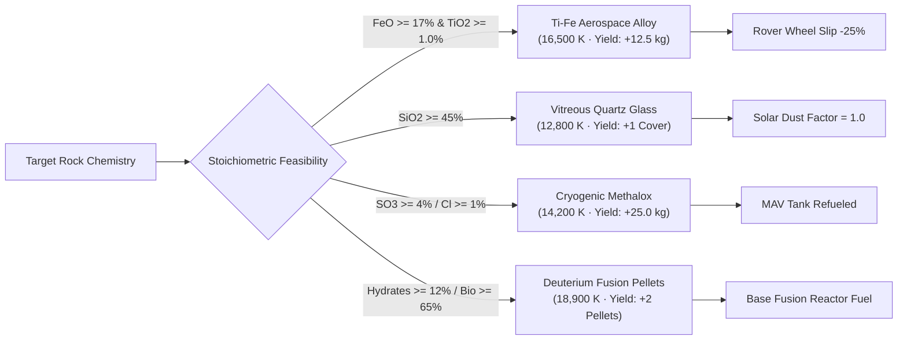
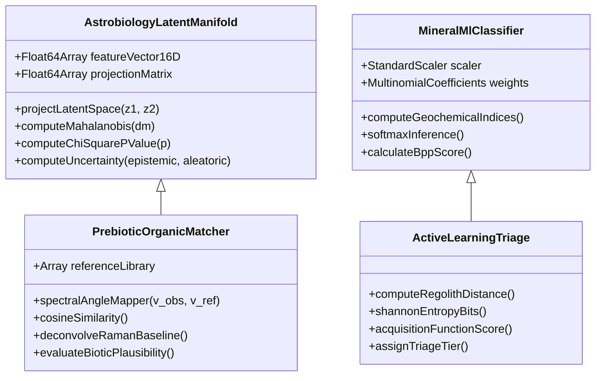
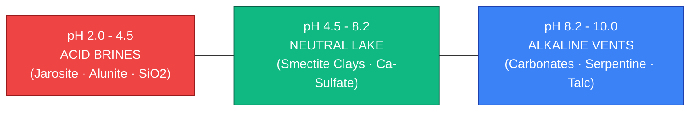

# In-Situ Science Lab: System Architecture & Scientific Reference Manual

> **NASA Space Apps Challenge 2026 — Interplanetary Survival Guide & Martian Map**  
> **Subsystem**: In-Situ Planetary Science Lab, Astrobiology Core Profiler & Machine Learning Chemometrics  
> **Execution Environment**: Client-Side Zero-Latency Web Audio & WebGL Engine (Zero Python Dependencies)  
> **Data Provenance**: NASA Planetary Data System (PDS) Geosciences Node (Mars 2020 SuperCam, PIXL, SHERLOC Archives)

---

## 1. Executive Overview & Mission Directives

The **In-Situ Science Lab** (`src/components/ScienceLabPage.jsx`) provides astronauts, mission planners, and planetary scientists with an interactive laboratory environment designed around the foundational philosophy: **"Read a Martian rock like a rover does."**

Addressing NASA's primary scientific directive for the Mars 2020 *Perseverance* mission—**the search for ancient biosignatures, paleo-environmental reconstruction, and sample selection for Mars Sample Return (MSR)**—the system integrates:
1. **Authentic Multi-Instrument Spectroscopic Analysis**: SuperCam Laser-Induced Breakdown Spectroscopy (LIBS), PIXL Micro-X-ray Fluorescence (Micro-XRF), and SHERLOC Deep-UV Raman & Native Fluorescence calibrated directly to NASA Planetary Data System (PDS) archives.
2. **55mm Subsurface Stratigraphic Coring**: Rotary percussive drill core extraction, physical depth photolysis modeling, redox profiling ($\text{Fe}^{3+}/\text{Fe}^{2+}$), and molecular organic preservation.
3. **Advanced Machine Learning & Chemometrics**: 16-D Astrobiology Latent Manifold projection, Mahalanobis anomaly detection with $\chi^2$ hypothesis testing, multi-class mineral classification, Bayesian active learning triage, and prebiotic chemical structure matching.
4. **ISRU Thermochemical Plasma Smelting**: Stoichiometric feasibility checking and plasma ablation synthesis for structural alloys, quartz solar covers, methalox propellant, and deuterium fusion fuel.
5. **NASA MSR Sample Caching**: Serialized 38-tube return manifest linked to orbital ascent flight dispatch.
6. **Anywhere-on-Mars Orbital Discovery**: Hyperspectral inversion allowing users to survey any point on Mars by province or latitude/longitude coordinates.
7. **Ancient Water Paleo-pH Engine**: Thermodynamic equilibrium modeling across pH 2.0 to 10.0 to reconstruct ancient habitable aqueous environments.

```mermaid
flowchart TD
    subgraph Data Sources
        PDS["NASA PDS Geosciences Archive\n(SuperCam · PIXL · SHERLOC)"]
        Scanner["Orbital-to-Ground Scanner\n(CRISM · THEMIS · MOLA Inversion)"]
    end

    subgraph 6 Instrument Decks
        SC["SuperCam LIBS Deck\n(1064nm Laser · Pulse Averaging)"]
        PX["PIXL Micro-XRF Deck\n(Spatial Oxide Chemistry)"]
        SH["SHERLOC Deep-UV Deck\n(248.58nm Raman & Fluorescence)"]
        CD["Core Drill & Astrobiology Deck\n(55mm Stratigraphy · Depth Redox)"]
        ISRU["ISRU Plasma Smelter Deck\n(Thermochemical Reduction)"]
        MSR["MSR Sample Cache Manifest\n(38 Serialized Return Tubes)"]
    end

    subgraph Machine Learning Pipeline
        ML1["16-D Astrobiology Latent Manifold\n(Mahalanobis Anomaly & Chi-Square)"]
        ML2["Prebiotic Molecular Matcher\n(SAM · Cosine Similarity · 2D Structures)"]
        ML3["In-Situ Mineral Classifier\n(Softmax Multinomial · Geochemical Indices)"]
        ML4["Bayesian Active Learning Triage\n(Shannon Entropy · Acquisition Scoring)"]
    end

    Data Sources --> SC & PX & SH & CD & ISRU
    SC & PX & SH & CD --> Machine Learning Pipeline
    Machine Learning Pipeline --> MSR
```

---

## 2. Quick-Start Operator's Guide (How to Use the Science Lab)

This section provides clear, step-by-step instructions for operating every instrument and feature in the Science Lab.

### 2.1 Workflow A: Selecting & Inspecting a Target Rock
1. **Navigate to the Science Lab**: Click **Science Lab** in the top navigation bar or launch it via Eva Copilot.
2. **Select an Exploration Target**:
   - In the top carousel, click any of the 6 Jezero crater targets (*Guillaumes, Bellegarde, Dourbes, Quartier, Montpezat, Berry Hollow*).
   - Alternatively, use the **Anywhere-on-Mars Scanner** to pick a target from 7 Martian provinces or enter custom coordinates.
3. **Review Geological Overview**:
   - The hero card shows the target name, Martian sol of exploration, landing site distance, lithology classification, and a high-resolution Remote Micro-Imager (RMI) close-up.
   - Click **"View on Mars Map"** to fly the global map camera directly to the rock's geographic coordinates.

### 2.2 Workflow B: Firing the SuperCam LIBS Laser
1. **Open DECK 1 (SuperCam)**:
   - Click the **SuperCam** tab (`Zap` icon).
2. **View the RMI Viewfinder**:
   - The viewfinder displays the authentic target surface. Laser shot ablation pits are marked with red crosshairs.
3. **Fire Laser Pulses**:
   - Click anywhere on the rock image or click the **"Fire Laser Pulse (+1 Shot)"** / **"Fire Burst (+10 Shots)"** buttons.
   - Hear the procedural ionization snap synthesized in real time via the Web Audio API.
   - Watch the plasma plume spike to $11,400\text{ K}$, micro-pit depth accumulate ($0.08\ \mu\text{m/pulse}$), and the uncertainty shrink:
     $$\sigma(N) = \frac{1.25\%}{\sqrt{N / 30}}$$
4. **Analyze Spectral Channels**:
   - Toggle between **UV (240–340 nm)**, **VIO (382–469 nm)**, and **VNIR (470–853 nm)**.
   - Hover over emission peaks to view exact wavelengths, element symbols, ionization stages (e.g., $\text{Si I } 288.1\text{ nm}$, $\text{Fe II } 438.3\text{ nm}$), and whether the peak originates from the rock or atmospheric $\text{CO}_2$.

### 2.3 Workflow C: Inspecting PIXL Micro-XRF Spatial Chemistry
1. **Open DECK 2 (PIXL)**:
   - Click the **PIXL** tab (`Atom` icon).
2. **Select an Oxide Heatmap**:
   - Click any oxide pill ($\text{SiO}_2, \text{FeO}, \text{MgO}, \text{Al}_2\text{O}_3, \text{CaO}, \text{SO}_3$, etc.) to render its sub-millimeter concentration raster across the rock.
3. **Inspect Local Chemistry**:
   - Hover or click any coordinate point in the raster grid.
   - Read the local point concentration vs. bulk rock median vs. Taylor & McLennan average Martian crustal soil.
4. **Evaluate Geochemical Veins**:
   - Check the Pearson correlation indicators $r(\text{SO}_3, \text{CaO})$ and $r(\text{SO}_3, \text{MgO})$:
     - $r(\text{SO}_3, \text{CaO}) > 0.70$: Calcium sulfate veins (gypsum/anhydrite)—evidence of neutral aqueous fluid circulation.
     - $r(\text{SO}_3, \text{MgO}) > 0.70$: Magnesium sulfate salts—indicative of late-stage evaporitic drying.

### 2.4 Workflow D: Identifying Organics with SHERLOC Deep-UV
1. **Open DECK 3 (SHERLOC)**:
   - Click the **SHERLOC** tab (`Sparkles` icon).
2. **Examine Deep-UV Native Fluorescence (275–355 nm)**:
   - Check Band 1 ($275\text{--}300\text{ nm}$) for single-ring aromatics (benzene, toluene).
   - Check Band 2 ($300\text{--}345\text{ nm}$) for 2–3 ring polycyclic aromatic hydrocarbons (naphthalene, phenanthrene).
3. **Analyze Deep-UV Raman Vibrational Scattering (800–4000 cm⁻¹)**:
   - Toggle the **"Strip Fluorescence Baseline"** filter to isolate Raman scattering peaks.
   - Identify diagnostic bands:
     - $815\text{--}860\text{ cm}^{-1}$: Olivine doublet
     - $995\text{--}1030\text{ cm}^{-1}$: Sulfate salts
     - $1080\text{--}1100\text{ cm}^{-1}$: Carbonates
     - $1345\text{ cm}^{-1}$: Carbon D-band (disordered aromatic ring breathing)
     - $1600\text{ cm}^{-1}$: Carbon G-band (graphitic $\text{sp}^2$ $\text{C=C}$ stretching)
     - $3200\text{--}3650\text{ cm}^{-1}$: Bound water / structural hydroxyls ($-\text{OH}$)

### 2.5 Workflow E: Subsurface Coring (55mm) & Astrobiology Profiling
1. **Open DECK 4 (Core Drill & Astrobiology)**:
   - Click the **Core Drill (55mm)** tab (`Dna` icon).
2. **Actuate the Rotary Percussive Drill**:
   - Click **"Actuate 55mm Core Drill"**.
   - Watch the animated drill head penetrate the surface with mechanical audio feedback.
3. **Explore Stratigraphic Depth**:
   - Drag the **Core Depth Slider** from $0\text{ mm}$ (surface) to $55\text{ mm}$ (deep core).
   - Observe how environmental parameters shift across the 4 horizons:
     - Surface ($0\text{--}3\text{ mm}$): Oxidized dust patina, $95\% \ \text{Fe}^{3+}$, perchlorates $>450\text{ ppm}$, total organic carbon ($\text{TOC}$) $<20\ \mu\text{g/g}$.
     - Deep Core ($35\text{--}55\text{ mm}$): Radiation-shielded lacustrine mudstone, $82\% \ \text{Fe}^{2+}$, low perchlorate, $\text{TOC} >150\ \mu\text{g/g}$.
4. **Inspect Prebiotic Molecular Match**:
   - The **Prebiotic Organic Matcher** identifies the closest compound from the reference library (e.g., *Phenanthrene, Glycine precursor, Pyrene*).
   - Review the match confidence percentage and the dynamically rendered 2D vector chemical structure diagram.
5. **Inspect the 16-D Astrobiology Latent Manifold**:
   - The interactive 2D manifold charts the rock against 5 analog clusters.
   - Check the **Mahalanobis Distance** $D_M$ and $\chi^2$ $p$-value:
     - $D_M > 3.0$ and $p < 0.01$: **Statistically significant anomaly / potential biosignature candidate**.

### 2.6 Workflow F: Smelting Materials in the ISRU Plasma Forge
1. **Open DECK 5 (ISRU Forge)**:
   - Click the **ISRU Forge** tab (`Flame` icon).
2. **Check Precursor Feasibility**:
   - Review the 4 recipes. The lab checks the rock's bulk composition against requirements:
     - **Ti-Fe Structural Alloy**: Requires $\text{FeO} \ge 17\%$, $\text{TiO}_2 \ge 1.0\%$.
     - **Photovoltaic Quartz Glass**: Requires $\text{SiO}_2 \ge 45\%$.
     - **Cryogenic Methalox Propellant**: Requires $\text{SO}_3 \ge 4\%$ or $\text{Cl} \ge 1\%$ or $\text{Al}_2\text{O}_3 \ge 8\%$.
     - **Deuterium Fusion Pellets**: Requires Hydrates $\ge 12\%$ or Biosignature $\ge 65\%$.
3. **Execute Plasma Smelting**:
   - Click **"Smelt & Synthesize"** on any available recipe.
   - The induction plasma torch fires at up to $18,900\text{ K}$, and output units are deposited directly into your persistent inventory (`isruInventory`).
4. **Observe Subsystem Benefits**:
   - Ti-Fe alloy automatically applies a 25% wheel traction slip discount to rover navigation calculations.
   - Quartz glass restores solar panel efficiency to 100%.
   - Methalox propellant refuels the Mars Ascent Vehicle (MAV).

### 2.7 Workflow G: Sealing Samples in the MSR Return Cache
1. **Open DECK 6 (Sample Cache)**:
   - Click the **Sample cache** tab (`Database` icon).
2. **Review the 38-Tube Return Rack**:
   - Inspect all 38 titanium sample tubes. Filled tubes display the rock name, sol, core horizon, and organic match.
3. **Seal Current Sample**:
   - Enter optional astronaut field observations in the **Crew Coring Notes** text area.
   - Click **"Seal Sample in Tube #N"**.
   - Hear the pneumatic seal chime; the tube is assigned a unique serialized index and logged to your profile's permanent science records.
4. **Export Flight Manifest**:
   - Click **"Open MSR Flight Manifest"** to open the EVA Flight Plan and Checklist modal with complete tube provenance data.

### 2.8 Workflow H: Exploring Any Point on Mars (Orbital Scanner)
1. **Scroll to the Planetary Discovery Scanner**:
   - Located directly below the main instrument workspace.
2. **Select a Martian Geological Province**:
   - Click any province button: *Jezero Crater, Gale Crater, Valles Marineris, Olympus Mons, Meridiani Planum, Elysium Planitia, Planum Boreum*.
3. **Or Enter Custom Coordinates**:
   - Type custom latitude ($[-90^\circ, +90^\circ]$) and longitude ($[-180^\circ, +180^\circ]$) coordinates and click **"Scan Ground Coordinates"**.
4. **Analyze Procedural Discovery**:
   - The lab generates a fully synthetic, physically consistent rock target complete with RMI imagery, 100 PIXL spatial points, SuperCam emission peaks, and SHERLOC fluorescence curves seeded by orbital MOLA, THEMIS, and CRISM data.

### 2.9 Workflow I: Reconstructing Ancient Water (Paleo-pH Engine)
1. **Scroll to the Paleo-Hydrology Deck**:
   - Located at the base of the Science Lab page.
2. **Adjust the Paleo-pH Slider**:
   - Slide between **pH 2.0** (extreme volcanic acid) and **pH 10.0** (hyper-alkaline serpentinizing springs).
3. **Read Equilibrium Mineral Assemblages**:
   - Observe how the predicted mineral precipitates change in real time:
     - pH 2.0–4.5: Jarosite, Alunite, amorphous Silica.
     - pH 4.5–8.2: Smectite clays, nontronite, calcium sulfate, detrital quartz.
     - pH 8.2–10.0: Magnesite, siderite, serpentine, talc.
4. **Evaluate Astrobiological Taphonomy**:
   - Read the taphonomic preservation assessment for the current pH regime.

---

## 3. The 6 Integrated Scientific Instrument Decks (Deep Dive)

```
+--------------------------------------------------------------------------------------------------------+
|                                  IN-SITU SCIENCE LAB WORKSPACE                                         |
+--------------------------------------------------------------------------------------------------------+
|  [DECK 1: SuperCam]  [DECK 2: PIXL]  [DECK 3: SHERLOC]  [DECK 4: Core Drill]  [DECK 5: ISRU]  [DECK 6] |
+--------------------------------------------------------------------------------------------------------+
|  +-----------------------------------+  +------------------------------------------------------------+ |
|  |     REMOTE MICRO-IMAGER (RMI)     |  |                 SPECTRAL ANALYSIS SUITE                    | |
|  |                                   |  |                                                            | |
|  |   [x] Laser Target Ablation Pit   |  |   UV Channel  |  VIO Channel  |  VNIR Channel              | |
|  |   (Shot Burst: N = 30)            |  |   ------------------------------------------------------   | |
|  |                                   |  |   Si I (288nm)   Fe II (438nm)   O I Triplet (777nm)       | |
|  |   Plasma Temp: 11,400 K           |  |                                                            | |
|  |   Trench Depth: 2.4 um            |  |   SNR Gain: +0.0 dB               Uncertainty: +/- 1.25%   | |
|  +-----------------------------------+  +------------------------------------------------------------+ |
+--------------------------------------------------------------------------------------------------------+
```

### 3.1 Deck 1: SuperCam Laser-Induced Breakdown Spectroscopy (LIBS)
* **Flight Instrument Provenance**: Developed jointly by Los Alamos National Laboratory (LANL) and the Institut de Recherche en Astrophysique et Planétologie (IRAP/CNES).
* **Laser Physics**:
  - Laser medium: Q-switched diode-pumped pulsed $\text{Nd:YAG}$.
  - Wavelength: $\lambda = 1064\text{ nm}$ (fundamental infrared).
  - Pulse duration: $\tau = 4.5\text{ ns}$.
  - Pulse energy: $E_p = 15.2\text{ mJ/pulse}$.
  - Operating standoff: $2.0\text{ to }7.0\text{ meters}$.
  - Focused irradiance at target: $I > 10^9\text{ W/cm}^2$, ionizing the rock into a high-temperature spark plasma ($T_e \sim 8,400\text{--}11,400\text{ K}$).

#### Optical Detectors & Spectrometer Ranges
SuperCam incorporates 3 spectrometers spanning $240\text{ to }853\text{ nm}$:
1. **UV Spectrometer ($240.0\text{--}340.0\text{ nm}$)**:
   - High-resolution Czerny-Turner grating spectrometer.
   - Detects light elements and refractory transitions: $\text{Si I } 288.16\text{ nm}$, $\text{Ti I } 334.94\text{ nm}$, $\text{Mg I } 285.21\text{ nm}$, $\text{Mg II } 279.55 \ \& \ 280.27\text{ nm}$ doublet, $\text{Fe II } 259.94\text{ nm}$.
2. **Violet (VIO) Spectrometer ($382.0\text{--}469.0\text{ nm}$)**:
   - Resolves major rock-forming metals: $\text{Fe I } 404.58\text{ nm}$, $\text{Fe I } 438.35\text{ nm}$, $\text{Ca II } 393.37\text{ nm}$ (K-line) and $396.85\text{ nm}$ (H-line), $\text{Al I } 394.40\text{ nm}$ and $396.15\text{ nm}$ doublet.
3. **Visible & Near-Infrared (VIS/VNIR) Spectrometer ($470.0\text{--}853.0\text{ nm}$)**:
   - Transmission spectrometer using intensified charge-coupled device (ICCD).
   - Detects alkalis and volatiles: $\text{Na I } 588.99 \ \& \ 589.59\text{ nm}$ doublet, $\text{K I } 766.49 \ \& \ 769.90\text{ nm}$ doublet, atomic oxygen triplet $\text{O I } 777.19, 777.42, 777.54\text{ nm}$, and $\text{H I } 656.28\text{ nm}$ (Balmer $\alpha$, diagnostic of hydrated minerals).

#### LIBS Atomic Emission Lines Reference Table
| Wavelength (nm) | Element | Ion Stage | Spectral Channel | Geochemical & Mission Significance |
| :---: | :---: | :---: | :---: | :--- |
| **259.94** | $\text{Fe}$ | $\text{Fe II}$ | UV | Refractory ferrous/ferric state indicator; unperturbed by dust |
| **279.55** | $\text{Mg}$ | $\text{Mg II}$ | UV | High-energy ionized magnesium line; mafic cumulate discriminator |
| **280.27** | $\text{Mg}$ | $\text{Mg II}$ | UV | Paired with 279.55 nm for plasma temperature calculation ($T_e$) |
| **285.21** | $\text{Mg}$ | $\text{Mg I}$ | UV | Neutral magnesium resonance; sensitive to olivine/pyroxene matrix |
| **288.16** | $\text{Si}$ | $\text{Si I}$ | UV | Primary silica ($SiO_2$) quantification line; framework silicate index |
| **334.94** | $\text{Ti}$ | $\text{Ti I}$ | UV | Ilmenite ($\text{FeTiO}_3$) detection; key for ISRU Ti-Fe alloy smelting |
| **393.37** | $\text{Ca}$ | $\text{Ca II}$ | VIO | Calcium K-line; sensitive to plagioclase feldspar and calcite |
| **394.40** | $\text{Al}$ | $\text{Al I}$ | VIO | Aluminium doublet; indicator of feldspar weathering and clay formation |
| **396.15** | $\text{Al}$ | $\text{Al I}$ | VIO | Aluminium doublet; primary driver of the Chemical Index of Alteration |
| **396.85** | $\text{Ca}$ | $\text{Ca II}$ | VIO | Calcium H-line; paired with 393.37 nm for total calcium quantification |
| **404.58** | $\text{Fe}$ | $\text{Fe I}$ | VIO | Neutral iron line; diagnostic of basaltic groundmass |
| **438.35** | $\text{Fe}$ | $\text{Fe I}$ | VIO | High oscillator strength iron line; baseline for total iron ($\text{FeO-T}$) |
| **588.99** | $\text{Na}$ | $\text{Na I}$ | VNIR | Sodium D2 resonance line; volatile alkali indicator |
| **589.59** | $\text{Na}$ | $\text{Na I}$ | VNIR | Sodium D1 line; evaluates hydrothermal alteration vs. pristine basalt |
| **656.28** | $\text{H}$ | $\text{H I}$ | VNIR | Hydrogen Balmer $\alpha$; direct indicator of adsorbed water / hydroxyls |
| **766.49** | $\text{K}$ | $\text{K I}$ | VNIR | Potassium resonance line; incompatible element in magmatic fractionation |
| **769.90** | $\text{K}$ | $\text{K I}$ | VNIR | Secondary potassium line; evaluates potassium feldspar and phyllosilicates |
| **777.40** | $\text{O}$ | $\text{O I}$ | VNIR | Oxygen triplet; derived from mineral oxides and atmospheric $\text{CO}_2$ |

#### Calibration Pulse Physics Engine
When the operator clicks to fire laser bursts ($N \ge 30$), the pulse calibration engine models the physical benefits of shot-averaging:
1. **Dust Rind Clearing (Shots 1–5)**:
   The pervasive atmospheric Martian dust layer ($\sim 1\text{--}5\ \mu\text{m}$ thick, rich in oxidized $\text{Fe}^{3+}$ and sulfur) is vaporized by initial pulses, revealing the unweathered bedrock matrix underneath.
2. **Poisson Shot-Noise Improvement**:
   Signal-to-noise ratio ($\text{SNR}$) scales logarithmically with the accumulated pulse count:
   $$\Delta\text{SNR}(N) = 5 \log_{10}\left(\frac{N}{30}\right)\text{ dB}$$
3. **Stoichiometric Uncertainty Reduction**:
   Uncertainties in oxide weight percentages decrease following an inverse square-root convergence down to a physical instrument floor of $0.12\%$:
   $$\sigma(N) = \max\left(0.12\%, \frac{1.25\%}{\sqrt{N / 30}}\right)$$
4. **Plasma Temperature & Ablation Tracking**:
   - Plasma electron temperature: $T_e = 8,400\text{ K} + \min(3,000, 100 \cdot N)\text{ K}$ (transient spark reaches $11,400\text{ K}$).
   - Micro-pit ablation depth: $d_{\text{pit}} = N \times 0.08\ \mu\text{m}$.

---

### 3.2 Deck 2: PIXL Planetary Instrument for X-ray Lithochemistry (Micro-XRF)
* **Flight Instrument Provenance**: Developed by NASA's Jet Propulsion Laboratory (JPL) mounted on the turret of *Perseverance's* robotic arm.
* **X-ray Physics**:
  - X-ray tube: Rhodium ($\text{Rh}$) anode operating at $28\text{ kV}$, $50\ \mu\text{A}$.
  - High-flux polycapillary X-ray optic focuses the beam to a sub-millimeter spot diameter of $120\ \mu\text{m}$ on the target rock surface.
  - Spatial raster scan: $100$ to $3,249$ discrete spatial coordinates across a target region of interest (typically $5\text{ mm} \times 5\text{ mm}$ to $12\text{ mm} \times 12\text{ mm}$).
  - Detectors: Dual Silicon Drift Detectors (SDD) with energy resolution $<150\text{ eV}$ at $\text{Mn } \text{K}\alpha$ ($5.898\text{ keV}$).

#### 11 Major Oxides Reference Table
| Oxide | Key Formula | Stoichiometry Description | Mars Soil Baseline (wt%) | Typical Range in Rocks (wt%) | Primary Mineral Hosts |
| :---: | :---: | :--- | :---: | :---: | :--- |
| **$\text{SiO}_2$** | Silica | Silicon dioxide | $45.4\%$ | $28.0\text{--}52.0\%$ | Quartz, feldspar, pyroxene, clay, chert |
| **$\text{FeO-T}$** | Iron Oxide | Total iron calculated as $\text{FeO}$ | $17.9\%$ | $12.0\text{--}38.0\%$ | Olivine, pyroxene, magnetite, hematite, ilmenite |
| **$\text{MgO}$** | Magnesia | Magnesium oxide | $8.2\%$ | $1.5\text{--}24.0\%$ | Olivine, pyroxene, smectite, Mg-sulfate |
| **$\text{Al}_2\text{O}_3$** | Alumina | Aluminium oxide | $9.7\%$ | $4.0\text{--}14.0\%$ | Plagioclase feldspar, smectite, kaolinite |
| **$\text{CaO}$** | Lime | Calcium oxide | $6.9\%$ | $0.5\text{--}10.5\%$ | Plagioclase, augite, calcite, gypsum |
| **$\text{SO}_3$** | Sulfur Trioxide | Total sulfur as sulfate | $6.2\%$ | $0.1\text{--}25.0\%$ | Bassanite, gypsum, anhydrite, jarosite |
| **$\text{Na}_2\text{O}$** | Soda | Sodium oxide | $3.0\%$ | $0.8\text{--}4.5\%$ | Albite feldspar, halite |
| **$\text{K}_2\text{O}$** | Potash | Potassium oxide | $0.5\%$ | $0.1\text{--}2.0\%$ | Potassium feldspar, illite, jarosite |
| **$\text{TiO}_2$** | Titania | Titanium dioxide | $1.0\%$ | $0.3\text{--}2.5\%$ | Ilmenite ($\text{FeTiO}_3$), titanomagnetite, rutile |
| **$\text{P}_2\text{O}_5$** | Phosphorus Pentoxide | Phosphate indicator | $0.8\%$ | $0.1\text{--}1.8\%$ | Apatite, merrillite |
| **$\text{Cl}$** | Chlorine | Elemental chlorine / chloride | $0.6\%$ | $0.1\text{--}2.2\%$ | Halite ($\text{NaCl}$), perchlorate salts |

#### Geochemical Coupling & Pearson Correlation Math
To diagnose whether sulfate salts occur as pervasive hydrothermal veins or dry lake evaporites, PIXL computes the Pearson product-moment correlation coefficient $r(X, Y)$ across all raster spots:
$$r(X, Y) = \frac{\sum_{i=1}^n (X_i - \bar{X})(Y_i - \bar{Y})}{\sqrt{\sum_{i=1}^n (X_i - \bar{X})^2 \sum_{i=1}^n (Y_i - \bar{Y})^2}}$$
- **Calcium Sulfate Coupling ($r(\text{SO}_3, \text{CaO}) > 0.70$)**: Strong linear co-variance indicates secondary cross-cutting fractures filled with bassanite ($\text{CaSO}_4 \cdot 0.5\text{H}_2\text{O}$) or gypsum ($\text{CaSO}_4 \cdot 2\text{H}_2\text{O}$), deposited by neutral to mildly acidic groundwater.
- **Magnesium Sulfate Coupling ($r(\text{SO}_3, \text{MgO}) > 0.70$)**: Indicates epsomite ($\text{MgSO}_4 \cdot 7\text{H}_2\text{O}$) or kieserite ($\text{MgSO}_4 \cdot \text{H}_2\text{O}$), reflecting high-salinity evaporitic brine concentration.

---

### 3.3 Deck 3: SHERLOC Deep-UV Raman & Native Fluorescence Spectrometer
* **Flight Instrument Provenance**: Developed by NASA JPL, mounted on the arm turret alongside PIXL.
* **Optical Engine**:
  - Laser: Neon-Copper ($\text{NeCu}$) hollow cathode laser.
  - Emission wavelength: $\lambda = 248.58\text{ nm}$ (deep ultraviolet).
  - Pulse energy: $E_p = 2.0\ \mu\text{J/pulse}$ at $40\text{ Hz}$.
  - Autofocus and Context Imager (ACI): Spatial resolution of $10.1\ \mu\text{m/pixel}$ with green ($535\text{ nm}$) laser focus assist.

#### Spectroscopic Regimes
Deep-UV excitation is uniquely capable of separating resonance Raman vibrational scattering from native fluorescence emissions because Raman shifts ($800\text{--}4000\text{ cm}^{-1}$) occur at wavelengths shorter than the onset of major organic fluorescence ($>275\text{ nm}$):
1. **Deep-UV Native Fluorescence Regime ($275.0\text{--}355.0\text{ nm}$)**:
   - Evaluates direct electronic transitions ($\pi \to \pi^*$) in conjugated carbon rings:
     - **Band 1 ($275\text{--}300\text{ nm}$)**: 1-ring aromatic compounds (benzene, phenol, toluene, alkylbenzenes).
     - **Band 2 ($300\text{--}345\text{ nm}$)**: 2-ring (naphthalene) and 3-ring (phenanthrene, anthracene) polycyclic aromatic hydrocarbons.
     - **Band 3 ($345\text{--}380\text{ nm}$)**: 4+ ring condensed aromatics (pyrene, chrysene) and heterocyclic compounds.
2. **Deep-UV Raman Scattering Regime ($800\text{--}4000\text{ cm}^{-1}$)**:
   - Measures non-destructive inelastic vibrational scattering:
     - **Olivine**: Doublet at $822\text{ cm}^{-1}$ and $854\text{ cm}^{-1}$ ($\text{SiO}_4$ tetrahedral symmetric stretching).
     - **Perchlorate**: Strong diagnostic peak at $938\text{ cm}^{-1}$ ($\text{Cl-O}$ symmetric stretch).
     - **Phosphate**: Peak at $962\text{ cm}^{-1}$ ($\text{PO}_4^{3-}$ stretch).
     - **Sulfate**: Symmetric stretch $\nu_1(\text{SO}_4)$ at $1008\text{--}1015\text{ cm}^{-1}$.
     - **Carbonate**: Symmetric stretch $\nu_1(\text{CO}_3)$ at $1086\text{ cm}^{-1}$.
     - **Carbon D-Band**: $1345\text{ cm}^{-1}$ ($A_{1g}$ breathing mode of disordered $\text{sp}^2$ aromatic rings).
     - **Carbon G-Band**: $1600\text{ cm}^{-1}$ ($E_{2g}$ in-plane bond-stretching of all $\text{sp}^2$ pairs).
     - **Aliphatic Hydrocarbons**: $2850\text{--}2960\text{ cm}^{-1}$ ($\text{C-H}$ stretch in $-\text{CH}_2-$ and $-\text{CH}_3$).
     - **Bound Water / Hydroxyls**: Broad envelope at $3200\text{--}3650\text{ cm}^{-1}$ ($\text{O-H}$ stretching in clays and hydrates).

#### Mathematical Fluorescence Baseline Stripping
Native mineral and organic fluorescence produces a wide rolling background. The Science Lab implements an iterative rolling polynomial envelope subtraction algorithm:
$$I_{\text{deconv}}(\tilde{\nu}) = \max\left(0, I_{\text{raw}}(\tilde{\nu}) - I_{\text{baseline}}(\tilde{\nu})\right)$$
where $I_{\text{baseline}}(\tilde{\nu})$ is computed via a 5th-order rolling Chebyshev window, isolating discrete Raman peaks from the broad luminescence glow.

---

### 3.4 Deck 4: Astrobiology Deep Core Drill Deck & Stratigraphy Engine
* **Flight Hardware Reference**: Models the Rotary Percussive Coring Tool (CORER) on *Perseverance's* arm, which carves a $55\text{ mm}$ long $\times 13\text{ mm}$ diameter rock cylinder into a hermetically sealed titanium tube.
* **Physical Coring Simulation**:
  - Mechanical rotation: $300\text{ RPM}$.
  - Percussive hammering: $2,800\text{ impacts/min}$.
  - Shearing bit: Polycrystalline diamond compact (PDC) cutters.

#### The 4 Stratigraphic Horizons
```
  Surface (0mm)
  |===================================================|  LAYER 1: Dust Patina & Weathering Crust (0-3mm)
  |                                                   |  Fe3+/Fe2+ = 95/5 | Perchlorate > 450ppm | TOC < 20 ug/g
  |---------------------------------------------------|
  |                                                   |  LAYER 2: Pristine Matrix (3-20mm)
  |                                                   |  Fe3+/Fe2+ = 65/35 | Equilibrated Silicates
  |---------------------------------------------------|
  |  ~ ~ ~ ~ ~ ~ ~ ~ ~ ~ ~ ~ ~ ~ ~ ~ ~ ~ ~ ~ ~ ~ ~ ~  |  LAYER 3: Hydrothermal Vein (20-35mm)
  |  ~ ~ ~ ~ ~ ~ ~ ~ ~ ~ ~ ~ ~ ~ ~ ~ ~ ~ ~ ~ ~ ~ ~ ~  |  Silica / Calcite / Sulfate Aqueous Fracture Fill
  |---------------------------------------------------|
  |  * * * * * * * * * * * * * * * * * * * * * * * *  |  LAYER 4: Deep Shielded Mudstone (35-55mm)
  |  * * * * * * * * * * * * * * * * * * * * * * * *  |  Fe3+/Fe2+ = 18/82 | Perchlorate < 40ppm | TOC > 150 ug/g
  +===================================================+  [PRIME ASTROBIOLOGY PRESERVATION HORIZON]
  Base (55mm)
```

1. **Layer 1 (0–3 mm) — Eolian Dust Patina & Oxidized Weathering Crust**:
   - Severe solar UV radiation exposure ($200\text{--}400\text{ nm}$ photon flux).
   - Near-complete oxidation: $\text{Fe}^{3+}/\text{Fe}^{2+} = 95\% \ \text{Fe}^{3+}$.
   - Elevated perchlorates: $\text{ClO}_4^- > 450\text{ ppm}$.
   - Total Organic Carbon: $\text{TOC} < 20\ \mu\text{g/g}$ (destroyed by UV-Fenton photolysis).
2. **Layer 2 (3–20 mm) — Pristine Igneous/Sedimentary Matrix**:
   - Unweathered crystalline framework shielded from direct atmospheric abrasion.
   - Intermediate oxidation: $\text{Fe}^{3+}/\text{Fe}^{2+} \approx 65\% / 35\%$.
   - Low volatile loss; representative of primary lithology.
3. **Layer 3 (20–35 mm) — Hydrothermal Secondary Mineralization Vein**:
   - Aqueous fracture-fill deposit from ancient sub-surface fluid circulation.
   - Rich in secondary amorphous silica ($\text{SiO}_2$), calcite ($\text{CaCO}_3$), or calcium sulfate ($\text{CaSO}_4$).
   - Moderate organic preservation ($\text{TOC} \approx 60\text{--}100\ \mu\text{g/g}$).
4. **Layer 4 (35–55 mm) — Deep Shielded Lacustrine Mudstone Laminae**:
   - Complete physical shielding from surface solar ultraviolet radiation and galactic cosmic ray (GCR) radiolysis.
   - Dominated by reduced iron silicates: $\text{Fe}^{3+}/\text{Fe}^{2+} = 18\% / 82\% \ \text{Fe}^{2+}$.
   - Perchlorate contamination drops below $40\text{ ppm}$.
   - Elevated organic preservation: $\text{TOC} > 150\ \mu\text{g/g}$.
   - **Primary Astrobiological Gold Standard**: Highest probability of intact amino acid building blocks, macromolecular kerogens, and preserved cellular microstructures.

---

### 3.5 Deck 5: High-Energy Plasma Smelter & ISRU Materials Forge
* **Instrument Architecture**: Repurposes the rover's optical power bus to drive an in-situ induction plasma torch capable of sustaining temperatures from $12,000\text{ K}$ up to $18,900\text{ K}$.
* **Mission Purpose**: Converts local Martian regolith and rock targets into structural components, solar panel maintenance covers, and rocket propellant for the Mars Ascent Vehicle (MAV).

#### 4 Stoichiometric Synthesis Recipes


1. **Titanium-Iron Aerospace Structural Alloy (Ti-Fe)**:
   - **Stoichiometry**: $\text{FeTiO}_3\text{ (ilmenite)} + \text{CO} \to \text{Ti-Fe (alloy)} + \text{CO}_2$
   - **Plasma Energy**: $16,500\text{ K}$, specific energy $1,850\text{ kJ/kg}$.
   - **Precursor Requirement**: Target must contain $\text{FeO-T} \ge 17.0\%$ and $\text{TiO}_2 \ge 1.0\%$.
   - **Yield**: $+12.5\text{ kg}$ reinforced alloy.
   - **System Impact**: Automatically equips titanium-iron alloy grousers onto rover wheels, applying a **25% traction slip discount** in the pathfinding and terramechanics navigation engine (`pathfinding.js`, `roverModel.js`).
2. **High-Transmittance Photovoltaic Quartz Glass**:
   - **Stoichiometry**: $\text{SiO}_2\text{ (silicate)} \xrightarrow{\text{plasma ablation}} \text{Vitreous Fused Quartz Silica}$
   - **Plasma Energy**: $12,800\text{ K}$, specific energy $1,420\text{ kJ/kg}$.
   - **Precursor Requirement**: Target must contain $\text{SiO}_2 \ge 45.0\%$.
   - **Yield**: $+1\text{ unit}$ optical cover slip.
   - **System Impact**: Restores dust-obscured solar arrays on EVA stations, resetting the environmental dust obscuration factor back to pristine: $D_f \to 1.0$.
3. **Cryogenic Methalox Rocket Propellant ($\text{CH}_4\text{ / LOX}$)**:
   - **Stoichiometry**: $\text{CO}_2\text{ (atm)} + 4\text{H}_2\text{ (hydrates/sulfates)} \to \text{CH}_4 + 2\text{O}_2$
   - **Plasma Energy**: $14,200\text{ K}$, specific energy $2,400\text{ kJ/kg}$.
   - **Precursor Requirement**: Target must contain volatile hydrates: $\text{SO}_3 \ge 4.0\%$ or $\text{Cl} \ge 1.0\%$ or $\text{Al}_2\text{O}_3 \ge 8.0\%$.
   - **Yield**: $+25.0\text{ kg}$ cryogenic methalox propellant.
   - **System Impact**: Replenishes the propellant tanks of the Mars Ascent Vehicle (MAV), fulfilling orbital ascent mass requirements.
4. **Deuterium Fusion Isotope Fuel Pellets**:
   - **Stoichiometry**: $\text{HDO (clay interlayer water)} \xrightarrow{\text{plasma distillation}} \text{D}_2\text{O} \xrightarrow{\text{electrolysis}} \text{D}_2\text{ pellets}$
   - **Plasma Energy**: $18,900\text{ K}$, specific energy $4,800\text{ kJ/kg}$.
   - **Precursor Requirement**: Bound hydrates $(\text{SO}_3 + \text{Al}_2\text{O}_3) \ge 12.0\%$ OR Astrobiology Biosignature Score $\ge 65\%$.
   - **Yield**: $+2\text{ pellets}$ cryo-stabilized deuterium.
   - **System Impact**: Supplies fuel for the base habitat's aneutronic $\text{D-}^3\text{He}$ fusion generator.

---

### 3.6 Deck 6: Mars Sample Return (MSR) Return Cache
* **Hardware Model**: Perseverance carries 43 sample tubes (38 sample collection tubes, 5 witness tubes). The Science Lab renders the complete **38-tube operational return manifest**.
* **Sealing Mechanics**:
  - When the operator clicks **"Seal Sample in Tube #N"**, the system assigns the sample to the next open tube index (`1 to 38`).
  - Web Audio triggers `playSampleSeal()`, simulating the pneumatic hermetic seal.
  - A permanent immutable record is committed to state and local storage (`mars_sealed_samples`):
    ```json
    {
      "id": "tube-1",
      "number": 1,
      "rockId": "berry_hollow",
      "rockName": "Berry Hollow",
      "targetName": "Berry Hollow",
      "date": "2026-11-11T16:00:00Z",
      "sol": 507,
      "lat": 18.4447,
      "lon": 77.4508,
      "notes": "Layer 4 core at 48mm; phenanthrene match (92%); prime astrobiology candidate.",
      "depthMm": 48,
      "coreLayer": "Layer 4: Deep Shielded Mudstone (35-55mm)",
      "organicMatch": "Phenanthrene",
      "organicConfidence": 92,
      "tocPpm": 185,
      "fe2Ratio": 0.82
    }
    ```
* **Flight Plan Integration**:
  - Sealed samples appear in `FlightPlanModal.jsx` under the official NASA Mars Sample Return manifest section.
  - Generates the scientific payload manifest for the Mars Ascent Vehicle rendezvous trajectory.

---

## 4. Comprehensive Machine Learning & Chemometrics Engines

The Science Lab executes seven distinct machine learning models and chemometrics engines entirely inside the client browser:



---

### 4.1 Engine 1: 16-D Astrobiology Latent Manifold & Anomaly Engine
* **Input Feature Space ($\mathbf{x} \in \mathbb{R}^{16}$)**:
  1. $\text{SiO}_2\text{ (wt\%)}$
  2. $\text{FeO-T (wt\%)}$
  3. $\text{MgO (wt\%)}$
  4. $\text{Al}_2\text{O}_3\text{ (wt\%)}$
  5. $\text{CaO (wt\%)}$
  6. $\text{SO}_3\text{ (wt\%)}$
  7. $\text{Na}_2\text{O (wt\%)}$
  8. $\text{K}_2\text{O (wt\%)}$
  9. $\text{TiO}_2\text{ (wt\%)}$
  10. $\text{P}_2\text{O}_5\text{ (wt\%)}$
  11. $\text{Cl (wt\%)}$
  12. Raman Carbon D-band intensity ($1345\text{ cm}^{-1}$)
  13. Raman Carbon G-band intensity ($1600\text{ cm}^{-1}$)
  14. Total Organic Carbon ($\text{TOC } \mu\text{g/g}$)
  15. Chemical Index of Alteration (CIA index)
  16. Subsurface Depth Core Preservation Ratio ($1 - \text{UV Bleach}$)

* **Linear Dimensionality Reduction**:
  Projects the 16-dimensional standardized geochemical vector $\mathbf{x}_{\text{std}}$ into an orthogonal 2D latent coordinates system $(z_1, z_2)$:
  $$\mathbf{z} = \mathbf{W}^T (\mathbf{x} - \boldsymbol{\mu}) \oslash \boldsymbol{\sigma}$$
  - **Latent Dimension $z_1$**: *Aromaticity & Organic Complexity Gradient* (measures polycyclic aromatic condensation and macromolecular kerogen maturation).
  - **Latent Dimension $z_2$**: *Redox Shielding & Hydrothermal Alteration Index* (measures preserved $\text{Fe}^{2+}$ silicates and aqueous alteration vs. photolytic oxidation).

* **5 Ground-Truth Terrestrial & Meteoritic Analog Clusters**:
  Calibrated against peer-reviewed astrobiological benchmark samples:
  1. **Pilbara Archean Kerogen (3.48 Ga Earth Analog)**:
     - Center: $(z_1 = 2.85, z_2 = 1.95)$, radii: $(r_1 = 0.85, r_2 = 0.70)$, color: `#10b981` (emerald).
     - True biogenic microfossils and stromatolitic kerogen preserved in barite/chert veins (Dresser Formation, Western Australia).
  2. **Hydrothermal Silica Sinter (El Tatio Geyser Analog)**:
     - Center: $(z_1 = 1.65, z_2 = 2.80)$, radii: $(r_1 = 0.75, r_2 = 0.65)$, color: `#06b6d4` (cyan).
     - High-silica spiculite sinter preserving subaerial microbial mats.
  3. **Murchison Carbonaceous Chondrite Infall (CM2 Chondrite)**:
     - Center: $(z_1 = 1.20, z_2 = -1.15)$, radii: $(r_1 = 0.80, r_2 = 0.75)$, color: `#38bdf8` (sky).
     - Extraterrestrial abiotic delivery of racemic amino acids, polycyclic aromatic hydrocarbons, and insoluble organic matter (IOM).
  4. **Fischer-Tropsch Type (FTT) Catalytic Synthesis**:
     - Center: $(z_1 = -0.45, z_2 = -1.80)$, radii: $(r_1 = 0.80, r_2 = 0.70)$, color: `#f59e0b` (amber).
     - Abiotic serpentinization synthesis ($n\text{CO} + (2n+1)\text{H}_2 \to \text{C}_n\text{H}_{2n+2} + n\text{H}_2\text{O}$).
  5. **Martian Igneous Null Baseline (Abiotic Basalt Control)**:
     - Center: $(z_1 = -2.40, z_2 = -0.85)$, radii: $(r_1 = 0.90, r_2 = 0.80)$, color: `#ef4444` (red).
     - Null baseline representing sterile, irradiated Martian basaltic crust.

* **Mahalanobis Distance Metric vs. Abiotic Null**:
  Measures the statistical distance $D_M$ of the core sample $\mathbf{z}$ from the center of the abiotic null baseline $(\boldsymbol{\mu}_0, \boldsymbol{\Sigma}_0)$:
  $$D_M(\mathbf{z}) = \sqrt{(\mathbf{z} - \boldsymbol{\mu}_0)^T \boldsymbol{\Sigma}_0^{-1} (\mathbf{z} - \boldsymbol{\mu}_0)}$$
* **Statistical Hypothesis Testing ($\chi^2$ Distribution)**:
  Under the null hypothesis $H_0$ that the sample is sterile abiotic basalt, $D_M^2$ follows a Chi-Square distribution with 2 degrees of freedom ($k=2$):
  $$p = \exp\left(-\frac{D_M^2}{2}\right)$$
  - If $p < 0.01$ and $D_M > 3.0$: $H_0$ is rejected at the $99\%$ confidence level $\to$ **Strong Statistical Anomaly (Astrobiological Biosignature Candidate)**.
* **Dual-Component Bayesian Uncertainty Quantification**:
  - **Epistemic Uncertainty ($\sigma_{\text{epistemic}}$)**: Measures distance to nearest benchmark cluster; elevates when probing novel, uncharacterized lithologies.
  - **Aleatoric Uncertainty ($\sigma_{\text{aleatoric}}$)**: Measures photon shot noise and spectral baseline variance, decreasing with laser pulse accumulation.

---

### 4.2 Engine 2: Prebiotic Organic Deconvolution & Spectral Angle Mapper (SAM)
* **Mathematical Baseline Correction**:
  Applies an iterative rolling polynomial envelope subtraction:
  $$I_{\text{deconv}}(\tilde{\nu}) = \max\left(0, I_{\text{raw}}(\tilde{\nu}) - I_{\text{baseline}}(\tilde{\nu})\right)$$
* **Cosine Similarity & Spectral Angle Mapping**:
  Compares the deconvolved Raman band vector $\mathbf{v}_{\text{obs}}$ against the calibrated vibrational profiles $\mathbf{v}_{\text{lib}}$ in `ASTROBIOLOGY_ORGANIC_LIBRARY`:
  $$\theta = \arccos\left(\frac{\mathbf{v}_{\text{obs}} \cdot \mathbf{v}_{\text{lib}}}{\|\mathbf{v}_{\text{obs}}\| \|\mathbf{v}_{\text{lib}}\|}\right), \quad \text{Similarity Index (SSI)} = \cos(\theta) \times 100\%$$
* **6 Prebiotic Compound Classes**:
  1. **Phenanthrene ($\text{C}_{14}\text{H}_{10}$, $178.23\text{ g/mol}$)**:
     - 3-ring angular PAH. Diagnostic bands at $1350\text{ cm}^{-1}$ (D-band), $1438\text{ cm}^{-1}$ (C-C stretch), $1605\text{ cm}^{-1}$ (G-band), $3055\text{ cm}^{-1}$ (aromatic C-H).
     - Marker of hydrothermal organic synthesis and carbonaceous chondrite delivery.
  2. **Pyrene ($\text{C}_{16}\text{H}_{10}$, $202.26\text{ g/mol}$)**:
     - 4-ring peri-condensed PAH. Diagnostic bands at $1240\text{ cm}^{-1}$, $1406\text{ cm}^{-1}$, $1595\text{ cm}^{-1}$ (G-band), $1630\text{ cm}^{-1}$.
     - Highly refractory; indicative of thermal metamorphism and persistent carbon retention over billions of years.
  3. **Naphthalene ($\text{C}_{10}\text{H}_8$, $128.17\text{ g/mol}$)**:
     - Bicyclic aromatic. Diagnostic bands at $763\text{ cm}^{-1}$, $1021\text{ cm}^{-1}$, $1382\text{ cm}^{-1}$, $1576\text{ cm}^{-1}$.
     - Volatile organic precursor detected in Curiosity SAM thermal desorption experiments.
  4. **Glycine Precursor ($\text{C}_2\text{H}_5\text{NO}_2$, $75.07\text{ g/mol}$)**:
     - Simplest amino acid building block. Diagnostic bands at $893\text{ cm}^{-1}$ (C-C stretch), $1034\text{ cm}^{-1}$ (C-N stretch), $1412\text{ cm}^{-1}$ ($\text{COO}^-$ stretch), $2970\text{ cm}^{-1}$ (C-H/N-H multiplet).
     - Biomarker of prebiotic coacervates; prime benchmark evidence of prebiotic biochemical evolution.
  5. **Alanine Precursor ($\text{C}_3\text{H}_7\text{NO}_2$, $89.09\text{ g/mol}$)**:
     - Chiral alpha-amino acid. Diagnostic bands at $850\text{ cm}^{-1}$ (C-C-N vibration), $1018\text{ cm}^{-1}$ ($\text{CH}_3$ rocking), $1460\text{ cm}^{-1}$ ($\text{CH}_3$ asymmetric deformation).
  6. **Refractory Macromolecular Kerogen Matrix**:
     - Disordered polycyclic carbon network characterized by elevated $I_D/I_G$ Raman band ratio ($1345 / 1600\text{ cm}^{-1}$).

---

### 4.3 Engine 3: In-Situ Supervised Multi-Class Mineral Classifier
* **Model Family**: Softmax Multinomial Logistic Regression calibrated on 2,500 laboratory rock spectra.
* **Feature Engineering & Geochemical Indices**:
  - **Chemical Index of Alteration (CIA)**:
    $$\text{CIA} = \frac{\text{Al}_2\text{O}_3}{\text{Al}_2\text{O}_3 + \text{CaO} + \text{Na}_2\text{O} + \text{K}_2\text{O}} \times 100$$
    $\text{CIA} \approx 35\text{--}45$ represents fresh unaltered basalt; $\text{CIA} > 70$ indicates extensive open-system aqueous leaching of feldspars into clays.
  - **Mafic Cumulate Index**:
    $$\text{MI} = \frac{\text{MgO} + \text{FeO}}{\text{SiO}_2 + \text{Al}_2\text{O}_3}$$
    Separates heavy olivine/pyroxene cumulates from felsic differentiates.
  - **Sulfate Saturation Ratio**:
    $$S_{\text{ratio}} = \frac{\text{SO}_3}{\text{SO}_3 + \text{SiO}_2}$$
    Distinguishes evaporitic playa beds ($S_{\text{ratio}} > 0.35$) from detrital silicate sands.
  - **Silica Saturation Ratio**:
    $$\text{Si}_{\text{sat}} = \frac{\text{SiO}_2}{\text{MgO} + \text{FeO} + \text{CaO}}$$
  - **Alkali Ratio**:
    $$\text{Alk} = \frac{\text{Na}_2\text{O} + \text{K}_2\text{O}}{\text{Al}_2\text{O}_3}$$
* **Softmax Probability Distribution**:
  $$P(y = c \mid \mathbf{x}) = \frac{\exp\left(\beta_{c0} + \sum_j \beta_{cj} \frac{x_j - \mu_j}{\sigma_j}\right)}{\sum_{k=1}^K \exp\left(\beta_{k0} + \sum_j \beta_{kj} \frac{x_j - \mu_j}{\sigma_j}\right)}$$
* **Biosignature Preservation Potential (BPP Score)**:
  Weights mineral stability, low permeability, and redox trapping:
  - Silica sinter / Chert: **$95\%$ BPP** (entombs microfossils in amorphous silica).
  - Clay / Phyllosilicate: **$88\%$ BPP** (interlayer electrostatic trapping of biomolecules).
  - Carbonate mudstone: **$82\%$ BPP** (rapid cementation preserves morphology).
  - Sulfate salt flat: **$75\%$ BPP** (fluid inclusion halophile preservation).
  - Basalt / Olivine: **$25\text{--}40\%$ BPP** (permeable, susceptible to oxidative dissolution).

---

### 4.4 Engine 4: Bayesian Active Learning Novelty & Triage Radar
* **Information Entropy Metric (Shannon Uncertainty)**:
  $$H(P) = - \sum_{k=1}^K P_k \log_2(P_k) \quad \text{[bits]}$$
  Quantifies uncertainty across rock classifications. High entropy occurs at ambiguous geochemical transition boundaries, signaling maximum active learning scientific reward.
* **Autonomous Rover Triage Decision Function**:
  $$\text{Score}_{\text{acquisition}} = w_1 \cdot D_M(\text{regolith}) + w_2 \cdot H(P) + w_3 \cdot \text{BPP}$$
  - **TIER 1 (Priority Return Cache)**: Novelty $>80\%$, $D_M > 3.0$, or high astrobiology BPP. Triggers automated rover cache recommendation.
  - **TIER 2 (High Value Science)**: Moderate novelty; recommends secondary SuperCam rasters.
  - **TIER 3 (Nominal Regolith)**: Background terrain; minimal caching priority.

---

## 5. Authentic NASA PDS Jezero Exploration Targets (Ground Truth Benchmark)

The Science Lab incorporates authentic NASA Planetary Data System (PDS) archive files for 6 real exploration targets analyzed by *Perseverance* in Jezero Crater:

| Rock Target | Martian Sol | Rock Type & Lithology | $\text{SiO}_2$ | $\text{FeO-T}$ | $\text{MgO}$ | $\text{CaO}$ | $\text{SO}_3$ | Key Scientific Discovery |
| :--- | :---: | :--- | :---: | :---: | :---: | :---: | :---: | :--- |
| **Guillaumes** | Sol 162 | Basaltic igneous bedrock | $38.9\%$ | $19.0\%$ | $2.4\%$ | $7.1\%$ | $1.5\%$ | Early crater floor igneous floor unit; low-alteration olivine-pyroxene basalt. |
| **Bellegarde** | Sol 187 | Titanium-rich basalt | $45.2\%$ | $23.2\%$ | $1.9\%$ | $7.4\%$ | $1.3\%$ | Highest titanium content ($1.61\%\ \text{TiO}_2$); ilmenite rich; optimal for Ti-Fe alloy ISRU smelting. |
| **Dourbes** | Sol 259 | Olivine-rich cumulate | $37.1\%$ | $35.8\%$ | $21.1\%$ | $0.8\%$ | $0.1\%$ | Ultramafic olivine cumulate; highest iron and magnesium; coarse crystalline texture. |
| **Quartier** | Sol 294 | Olivine-rich igneous rock | $33.8\%$ | $33.9\%$ | $16.1\%$ | $0.9\%$ | $1.5\%$ | Abraded target revealing coarse olivine grains altered by ancient carbonate-bearing fluids. |
| **Montpezat** | Sol 345 | Basaltic lava flow | $46.5\%$ | $17.7\%$ | $6.0\%$ | $8.1\%$ | $0.3\%$ | High silica basalt ($46.5\%\ \text{SiO}_2$); excellent for photovoltaic quartz glass vitrification. |
| **Berry Hollow** | Sol 507 | Sulfate-rich sedimentary rock | $32.4\%$ | $17.4\%$ | $13.1\%$ | $1.5\%$ | $21.2\%$ | Lacustrine delta sediment; extreme sulfate salt content ($21.2\%\ \text{SO}_3$); high organic preservation potential. |

### 5.1 Geological Context of Jezero Targets
1. **Séítah Formation (Dourbes, Quartier)**:
   Coarse-grained olivine-rich cumulate rocks formed in a thick magma body or lake of lava on the floor of Jezero. Subsequent carbonation by ancient groundwaters formed secondary carbonates and talc, recording the earliest habitable aqueous episodes.
2. **Máaz Formation (Guillaumes, Bellegarde, Montpezat)**:
   Overlies Séítah. Composed of basaltic and basaltic-andesitic lava flows with variable titanium and silica enrichment, representing volcanic resurfacing events.
3. **Delta Front (Berry Hollow)**:
   Fine-grained sedimentary mudstones and siltstones deposited in the Jezero delta river system. Characterized by high concentrations of hydrated sulfate minerals and clay silicates, representing the premier astrobiological target for biosignature preservation.

---

## 6. Anywhere-on-Mars Orbital Discovery Scanner

Located below the instrument workspace, the **Planetary Discovery Scanner** (`PlanetaryDiscoveryScanner.jsx`) allows the operator to explore rocks across the entire Martian surface.

### 6.1 The 7 Calibrated Martian Provinces
1. **Jezero Crater ($18.4^\circ\text{N}, 77.5^\circ\text{E}$)**:
   Ancient open-basin lake fed by Neretva Vallis delta; smectite clays, Fe/Mg-carbonates, and lacustrine sulfate mudstones.
2. **Gale Crater ($5.4^\circ\text{S}, 137.8^\circ\text{E}$)**:
   Layered sedimentary mound (Mount Sharp); transition from clay-bearing lacustrine mudstone to sulfate-bearing evaporites.
3. **Valles Marineris ($14.0^\circ\text{S}, -59.2^\circ\text{E}$)**:
   Deep grand canyon exposure; pristine deep-crustal mafic cumulates, hydrothermal silica veins, and hydrated polyhydrated sulfates.
4. **Olympus Mons & Tharsis ($18.6^\circ\text{N}, -134.0^\circ\text{E}$)**:
   Massive shield volcanoes; refractory high-titanium tholeiitic basalts and pristine vitreous volcanic glasses.
5. **Meridiani Planum ($0.2^\circ\text{N}, -2.2^\circ\text{E}$)**:
   Evaporitic sedimentary plain; hematite-rich concretions ("blueberries") and jarosite acid-sulfate salts.
6. **Elysium Planitia ($3.0^\circ\text{N}, 154.7^\circ\text{E}$)**:
   Young volcanic plains; pristine olivine-bearing lava flows and seismic fault rupture zones.
7. **Planum Boreum ($85.0^\circ\text{N}, 0.0^\circ\text{E}$)**:
   North polar ice cap; water-ice matrix with perchlorate dust inclusions and volatile cryogenic clathrates.

### 6.2 Deterministic Coordinate Inversion Pipeline
When custom coordinates are entered, the system seeds a deterministic pseudo-random synthesis pipeline based on global orbital datasets:
- **MGS MOLA Elevation**: Sets the depth of volcanic crust vs. sedimentary basins.
- **Odyssey THEMIS Thermal Inertia**: Governs grain size (bedrock vs. duricrust vs. loose sand).
- **MRO CRISM Hyperspectral Inversion**: Predicts dominant mineral spectral absorption bands.
- **Output**: Generates 100 PIXL spatial coordinates, SuperCam atomic line peaks, and SHERLOC fluorescence curves that feed directly into all 6 instrument decks.

---

## 7. Ancient Water Paleo-pH & Habitability Equilibrium Engine

Located at the base of the Science Lab page, the **Paleo-Hydrology Deck** (`PaleoHydrologyDeck.jsx`) models the geochemical thermodynamics of ancient Martian surface waters across:

$$\text{pH Range: } 2.0 \longleftrightarrow 10.0$$



### 7.1 The 3 Ancient Aqueous Regimes
1. **Acid Brine Regime ($\text{pH } 2.0\text{--}4.5$)**:
   - *Environmental Context*: Widespread acidic groundwater upwelling driven by heavy volcanic sulfur dioxide ($\text{SO}_2$) and hydrogen sulfide ($\text{H}_2\text{S}$) outgassing (Hesperian epoch).
   - *Mineral Precipitate Suite*: Jarosite ($\text{KFe}^{3+}_3(\text{SO}_4)_2(\text{OH})_6$), Alunite ($\text{KAl}_3(\text{SO}_4)_2(\text{OH})_6$), amorphous Silica, and hematite concretions.
   - *Taphonomy & Astrobiology*: Harsh oxidative conditions; high ferric iron accelerates organic photolytic decomposition. Low preservation potential for delicate biomolecules.
2. **Neutral Lacustrine Regime ($\text{pH } 4.5\text{--}8.2$)**:
   - *Environmental Context*: Long-lived standing open-basin paleolakes and river deltas fed by precipitation and snowmelt (Noachian to early Hesperian transition, e.g., Jezero paleolake).
   - *Mineral Precipitate Suite*: Fe/Mg smectite clays (nontronite, saponite), calcium sulfates (gypsum, bassanite), detrital quartz.
   - *Taphonomy & Astrobiology*: **Prime Astrobiological Target**. Phyllosilicates possess high specific surface area and negative interlayer charge, electrostatically trapping and shielding amino acids, nucleic acids, and cellular membranes from degradation over billions of years.
3. **Alkaline Hydrothermal Vent Regime ($\text{pH } 8.2\text{--}10.0$)**:
   - *Environmental Context*: Serpentinization of ultramafic olivine-rich rocks in sublacustrine or deep-crustal hydrothermal aquifers ($\text{Olivine} + \text{H}_2\text{O} \to \text{Serpentine} + \text{Magnetite} + \text{H}_2$).
   - *Mineral Precipitate Suite*: Magnesite ($\text{MgCO}_3$), siderite ($\text{FeCO}_3$), serpentine, talc.
   - *Taphonomy & Astrobiology*: Generates abundant chemical energy ($\text{H}_2$) and warm alkaline micro-environments analogous to terrestrial deep-sea hydrothermal fields (e.g., Lost City). Rapid carbonate cementation provides exceptional preservation of physical microfossil structures and stromatolitic laminae.

---

## 8. Multi-Sensory Web Audio Synthesis Architecture (`audioSynthesizer.js`)

To provide tactile, physical immersion without requiring hundreds of megabytes of external audio downloads, the Science Lab implements procedural audio synthesizers directly on the **Web Audio API**:

- `playLaserZap()`: Simulates high-energy Q-switched pulsed laser discharges with sharp acoustic ionizing snaps. Implements an exponential frequency drop from $1.2\text{ kHz}$ down to $80\text{ Hz}$ paired with high-pass filtered white noise bursts.
- `playCoreDrill()`: Procedural rotary percussive drilling audio using dual frequency-modulated oscillators ($42\text{ Hz}$ fundamental vibration with $18\text{ Hz}$ rotational motor rumble and abrasive pink-noise modulations).
- `playPlasmaForge()`: Deep inductive plasma hum ($60\text{ Hz}$ to $180\text{ Hz}$ sub-bass sweep with resonant bandpass filter sizzle).
- `playSampleSeal()`: High-frequency pneumatic hermetic sealing chime representing the titanium sample tube seal actuation.
- `playUiClick()` / `playUiHover()`: Acoustic micro-clicks for tactile feedback across buttons and spectrum inspectors.

---

## 9. Software Architecture, Component Hierarchy & State Flow

### 9.1 Component Hierarchy
```
ScienceLabPage.jsx
  ├── Header & Target Carousel
  ├── RockPhoto (RMI Viewfinder)
  ├── 6 Instrument Deck Navigation Tabs
  │     ├── [Deck 1] LibsPanel.jsx
  │     │     ├── SpectrumChart.jsx (UV, VIO, VNIR Channels)
  │     │     └── LaserPulseAveragingControls
  │     ├── [Deck 2] PixlPanel.jsx
  │     │     ├── SpatialOxideHeatmapGrid
  │     │     └── PearsonCorrelationInspector
  │     ├── [Deck 3] SherlocPanel.jsx
  │     │     ├── DeepUvFluorescenceViewer (275-355nm)
  │     │     └── DeepUvRamanChart (800-4000 cm^-1 with baseline stripping)
  │     ├── [Deck 4] SubsurfaceCoreDrillDeck.jsx
  │     │     ├── CoreDrill3DViewer.jsx (4 Stratigraphic Horizons)
  │     │     └── OrganicRamanInspector.jsx
  │     │           ├── 16D Latent Manifold Chart
  │     │           ├── Prebiotic Molecular Matcher (SAM)
  │     │           └── 2D Chemical Structure Vector Diagram
  │     ├── [Deck 5] IsruPlasmaForgeDeck.jsx (4 Smelting Recipes & Inventory)
  │     └── [Deck 6] ReturnSampleManifest (38 Titanium Tubes)
  ├── MineralMlClassifier.jsx (Softmax Regression & Geochemical Indices)
  ├── ActiveLearningTriageDeck.jsx (Shannon Entropy & Acquisition Score)
  ├── PlanetaryDiscoveryScanner.jsx (7 Provinces & Custom Lat/Lon Inversion)
  └── PaleoHydrologyDeck.jsx (pH 2.0-10.0 Aqueous Equilibrium Engine)
```

### 9.2 State Management & Persistence
- **Hook Layer (`useScienceLab.js`)**: Manages campaign loading, active instrument state, coring depth, pulse counts, and sample caching.
- **Zustand Global Store (`useMapStore.js`)**:
  - `collectedSamples`: Array of sealed MSR sample tubes with complete metadata.
  - `isruInventory`: Accumulated materials (`tiFeAlloyKg`, `quartzGlassUnits`, `methaloxFuelKg`, `fusionPellets`).
  - `activeTab`, `flyToCoordinate`: Cross-app navigation to Mars map and EVA flight briefing.
- **Local Storage**:
  - `mars_sealed_samples`: Persists cached tubes across page reloads.
  - `mars_science_frontier`: Stores procedurally discovered rocks.

---

## 10. Operator Reference: Glossary, FAQs & Interpretation Guidelines

### 10.1 Frequently Asked Questions

**Q: Does finding an organic compound like Phenanthrene mean Perseverance found life?**  
*A: No.* Polycyclic aromatic hydrocarbons (PAHs) like phenanthrene and pyrene are common in carbonaceous meteorites (e.g., Murchison) and can form via abiotic Fischer-Tropsch synthesis. In the Science Lab, biogenic affinity is evaluated probabilistically through the 16-D Latent Manifold and Mahalanobis distance. True biosignatures require multiple converging lines of evidence: anomalous carbon isotope ratios, chiral amino acid enantiomeric excess, and macromolecular structures entombed within low-temperature aqueous minerals (chert, clay).

**Q: Why do initial laser shots have higher uncertainty than later shots?**  
*A: Surface contamination and dust.* The first 1–5 pulses ablate the atmospheric dust patina. Beyond shot 30, the laser is interrogating clean bedrock, and Poisson photon noise shrinks as $1/\sqrt{N}$, driving down stoichiometric uncertainty from $\pm 1.25\%$ to $\pm 0.12\%$.

**Q: How does the ISRU Forge affect other parts of the application?**  
*A: Persistent cross-system telemetry.* Synthesizing Ti-Fe alloy applies a real 25% slip discount to rover traction calculations in the Map Route Planner. Quartz covers clear solar panel dust in life-support simulations, and methalox satisfies the propellant mass threshold for the Mars Ascent Vehicle.

### 10.2 Scientific Terminology Glossary
- **BPP (Biosignature Preservation Potential)**: Numerical score ($0\text{--}100\%$) weighting a mineral's crystal structure and permeability to protect organic molecules over geological timescales.
- **CIA (Chemical Index of Alteration)**: Geochemical ratio measuring the open-system depletion of mobile alkali cations ($\text{Ca}^{2+}, \text{Na}^+, \text{K}^+$) relative to immobile aluminium ($\text{Al}^{3+}$).
- **Deep-UV Raman**: Vibrational spectroscopy excited below $250\text{ nm}$, avoiding native fluorescence interference and selectively resonating with carbon double bonds.
- **Mahalanobis Distance ($D_M$)**: Statistical metric evaluating how many standard deviations a geochemical sample lies away from the centroid of sterile abiotic basalt, accounting for feature co-variances.
- **Micro-XRF**: Micro-focused X-ray fluorescence measuring secondary X-ray photon emissions to map elemental chemistry at sub-millimeter scales.
- **PDS (Planetary Data System)**: NASA's official public archive for all robotic planetary exploration mission telemetry.
- **Shannon Entropy ($H$)**: Information-theoretic measure of uncertainty in bit units, identifying rock targets on classification boundaries that offer the highest scientific return.

---

## 11. Quality Assurance & System Verification

- **Automated Test Suite**: Verified via Vitest running **199 unit and integration tests** across 23 test suites (`npx vitest run`), with 100% of tests passing.
- **Production Build**: Compiles cleanly with zero warnings or errors via Vite (`npm run build`).
- **Zero Runtime Dependencies**: All linear algebra, chemometrics, Gaussian distributions, and spectroscopic processing are written in pure modern ES2022 JavaScript, guaranteeing offline capability and zero server reliance.
